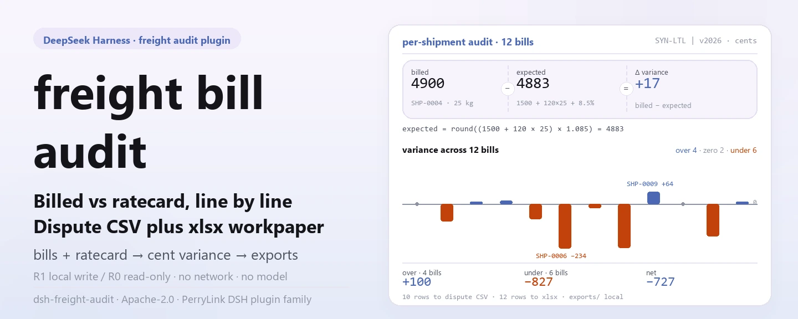

<div align="center">

<picture>
  <source media="(prefers-color-scheme: dark)" srcset="docs/assets/dsh-freight-audit-hero-en-dark.webp">
  
</picture>

# dsh-freight-audit

**Reconcile carrier bills line by line against your ratecard — see what was overcharged, what was undercharged, and export the dispute file plus workpaper.**

A purely local freight-audit plugin for DeepSeek Harness: versioned ratecards, expected cost from base + per-kg × weight plus a fuel percentage, cent-level variance, and an xlsx workpaper with a dispute CSV — no network, no model call, no upload.

[Install](#three-step-setup) · [Configuration](#configuration) · [FAQ](#faq) · [简体中文](README.md) · [English](README.en.md) · [Español](README.es.md) · [Português](README.pt.md) · [हिन्दी](README.hi.md)

[](LICENSE)
[](#compatibility)
[](https://www.npmjs.com/package/dsh-freight-audit)
[](https://github.com/PerryLink/dsh-freight-audit/actions/workflows/ci.yml)
[](#compatibility)

[](https://github.com/PerryLink/dsh-freight-audit/stargazers)
[](https://www.npmjs.com/package/dsh-freight-audit)
[](https://dshfind.com/plugins/PerryLink/dsh-freight-audit?ref=badge)
[](https://dsh.market/)
[](https://gitee.com/perrylink/dsh-freight-audit)

```sh
dsh plugin --profile <profile> add dsh-freight-audit
```

</div>

<sub>Community plugin, not affiliated with DeepSeek. Canonical repository: <https://github.com/PerryLink/dsh-freight-audit> (Gitee is a mirror). Status: alpha · verified on public/synthetic data only · not GA — no customer data or customer evidence, no production-readiness claim.</sub>

## What it is

A local pipeline for freight reconciliation: `freight.ratecard` stores one carrier/version ratecard in the local storage domain (base price, per-kg price, fuel percentage, effective window), `freight.audit` reads a CSV batch of bills and computes expected cost per shipment as `base_cents + per_kg_cents × weight_kg` plus `fuel_pct`, records the variance in cents on each bill, `freight.recovery_summary` aggregates overcharge/undercharge/net, and `freight.dispute` and `freight.export` write the dispute CSV and xlsx workpaper. Everything runs on your machine — no network, no model call, no upload; inputs are read by the session and passed to the tools as arguments, and the original files are never touched.

- **Good fit**: monthly freight bills of tens to thousands of shipments (CSV); checking the variance first, then deciding how much to recover from the carrier.
- **Not a fit**: manual records without weight or amount; direct TMS / carrier-portal integration (this package connects to no external system); replacing a formal claim or legal process.

<picture>
  <source media="(prefers-color-scheme: dark)" srcset="docs/assets/dsh-freight-audit-flow-v5-dark.svg">
  
</picture>

## Three-step setup

1. **Install** (pick one channel):

   ```sh
   # npm channel (recommended; published releases)
   dsh plugin --profile <profile> add dsh-freight-audit
   # git channel (latest main; equivalent to git+https://github.com/PerryLink/dsh-freight-audit.git)
   dsh plugin --profile <profile> add github:PerryLink/dsh-freight-audit
   # tarball channel: pnpm pack in this repo, then
   dsh plugin --profile <profile> add ./dsh-freight-audit-<version>.tgz
   ```

2. **Minimal config** (the install command already applies the bundle patch; hand-written profiles paste this one row):

   ```yaml
   - insert:
       - id: dsh-freight-audit
         name: dsh-freight-audit
   ```

   The plugin has no plugin-level config keys; ratecard fields, bill headers, and the zone table are passed as tool arguments — see "Configuration".

3. **Verify it mounts**:

   ```sh
   dsh --profile <profile> --dump-config | grep dsh-freight-audit
   ```

   A synthetic sample ships with the repo — run it once (it should end with `quickstart ok`):

   ```sh
   node samples/quickstart/run.mjs --check
   ```

Inside a session you can also simply ask for it — the one-line demo prompt shipped in `package.json` as `dsh.demo.prompt`:

```text
我有一车承运商账单，帮我按费率卡逐票核对，把多收少收的差额和要追回的金额算出来。
```

**Uninstall**: `dsh plugin --profile <profile> remove dsh-freight-audit` (or remove the row from the profile patch).

<details>
<summary>Install from the DSH Desktop market</summary>

Every PerryLink plugin is listed in the built-in DSH Desktop market: **Market → Sources → Add source → paste** `https://perrylink-dsh-catalog.perrylink.workers.dev/catalog-source.json` **→ select**. Installation still requires the market's npm identity check and your confirmation.

</details>

## Core capabilities

- **Versioned ratecards** — `freight.ratecard` with `set` stores a ratecard and `list` reads them all; two versions of the same carrier whose effective windows overlap are rejected loudly (`E_FREIGHT_RATE_OVERLAP`), and a missing `effective_to` means the version stays open-ended.
- **Per-shipment audit and variance** — `freight.audit` parses the bill CSV, computes expected cost and variance per shipment (in cents), writes the per-shipment result into the local storage domain, and returns the list of outlier shipment ids.
- **Recovery summary** — `freight.recovery_summary` aggregates overcharge, undercharge, and net for a carrier/version; read-only, it never overwrites stored bills.
- **Dispute export** — `freight.dispute` selects only non-zero variances and exports a dispute-review CSV; text fields are formula-injection-neutralized, the path goes through the safe-path guard, and nothing is submitted to the carrier.
- **Workpaper export** — `freight.export` writes per-shipment `billed/expected/variance` to a single xlsx sheet and returns the path and row count.
- **Zone list-rate lookup** — `freight.zone_lookup` reads a public zone/rate CSV and returns the published rate for one zone; read-only, never folded into the audit math.
- **Ratecard and accessorial hygiene** — `freight.ratecard_validate` checks money fields, fuel share, effective window, and version overlap; `freight.accessorial_check` checks accessorial type, integer amount, duplicates, agreed-list membership, and a total cap.
- **Purely local** — no HTTP / DNS / WebSocket calls in the source; no TMS or carrier-system connections, nothing uploaded.

### Tool surface

Tool names are a stable API. Tools that write local files are marked **R1 (local write)**, read-only tools **R0**. `freight.audit` writes per-shipment results into the local storage domain, so it is marked R1 as well.

| Tool | Purpose | Risk |
|---|---|---|
| `freight.ratecard` | Register/version a freight ratecard; `set` writes, `list` is read-only | R1 local write (`set`) |
| `freight.audit` | Audit carrier bills against the ratecard; write expected/variance per shipment | R1 local write |
| `freight.zone_lookup` | Look up a public zone/rate table | R0 read-only |
| `freight.recovery_summary` | Summarize over/under/net recovery | R0 read-only |
| `freight.dispute` | Export a variance CSV for dispute review | R1 local write |
| `freight.export` | Export the audit xlsx workpaper | R1 local write |
| `freight.ratecard_validate` | Ratecard hygiene: money fields, fuel share, effective window, version overlap | R0 read-only |
| `freight.accessorial_check` | Accessorial validation: type, amount, duplicates, agreed list, total cap | R0 read-only |

### Input and output

Input:

- Bill CSV: UTF-8, header `shipment_id,weight_kg,billed`; `billed` carries the amount (e.g. `23.00`) and `weight_kg` is a positive number.
- Ratecard JSON: `carrier`, `version`, `base_cents`, `per_kg_cents`, `fuel_pct`, `effective_from`, optional `effective_to`.
- Zone CSV: header `zone,list_rate`; `list_rate` is in currency units and the tool converts it to cents.
- Size: keep each batch ≤5 MB (about 20,000 shipments); the bundled sample has 12 shipments, about 0.3 KB.
- Source: export from your TMS or the carrier's monthly statement and save as CSV; the original file is never modified.

Output:

- Terminal summary: bill count, outlier bills, total variance, overcharge/undercharge/net, zone list rate, and ratecard/accessorial issues.
- Files: the `xlsx` workpaper (per-shipment `billed/expected/variance`) and the dispute `CSV`, under `$DSH_HOME/storages/dsh-freight-audit/exports/`; the original bill is untouched.
- Sample gold file: `samples/quickstart/expected/result.json` (produced by a real run).

### Examples

Bundled synthetic sample (shipped with the package, not real carrier data):

```sh
node samples/quickstart/run.mjs          # human-readable summary
node samples/quickstart/run.mjs --json   # canonical result (source of the gold file)
node samples/quickstart/run.mjs --check  # diff against the gold file, ends with quickstart ok
```


*The screenshot is the real terminal output of `node samples/quickstart/run.mjs --check`; the command and output hashes are recorded in `screenshots.json` (real run on 2026-11-02), and the gold file is `samples/quickstart/expected/result.json`.*

Public-fixture acceptance: re-run `node scripts/acceptance.mjs`; details in `ACCEPTANCE.csv`:

| req_id | metric | threshold | actual | pass | source | counted |
|---|---|---|---|---|---|---|
| SKU-12-A01 | Bill parsing (30) | 30/30 | 30 | true | public/synthetic | false |
| SKU-12-A02 | Outlier bills | 5 | 5 | true | public/synthetic | false |
| SKU-12-A03 | Total variance (cents) | 500 | 500 | true | public/synthetic | false |
| SKU-12-A04 | Workpaper sheet | 1 | 1 | true | public/synthetic | false |
| SKU-12-A05 | Public zone rate | 2327 | 2327 | true | public/synthetic | false |
| SKU-12-A06 | Recovery net | 100 | 100 | true | public/synthetic | false |
| SKU-12-A07 | Ratecard overlap detection | 1 | 1 | true | public/synthetic | false |
| SKU-12-A08 | Accessorial validation | 1 | 1 | true | public/synthetic | false |
| PS1-QS01 | Quickstart sample matches gold | 1/1 | 1 | true | synthetic/quickstart | true |

*The SKU rows are public/synthetic fixture checks (`counted=false`); PS1-QS01 is a local reproduction of the shipped sample (`counted=true`). Neither is a customer run, and no output is invented.*

## Configuration

This plugin has no Schemastery `Config` keys — `cordis.patch.yml` only `insert`s one row (see "Three-step setup"), so there is no plugin-level key to override. Ratecard fields are passed when calling `freight.ratecard`:

| Field | Type | Meaning |
|---|---|---|
| `carrier` | string, required | Carrier id, e.g. `SYN-LTL` |
| `version` | string, required | Ratecard version, e.g. `v2026` |
| `base_cents` | non-negative integer (cents) | Base price per shipment |
| `per_kg_cents` | non-negative integer (cents/kg) | Price per kilogram |
| `fuel_pct` | number 0–100 | Fuel surcharge percentage; expected = (base + per_kg × weight) × (1 + fuel_pct/100) |
| `effective_from` | `YYYY-MM-DD` | Effective start date |
| `effective_to` | `YYYY-MM-DD`, optional | Effective end date; omitted = `9999-12-31` |

Bill and zone inputs:

| Input | Header | Rule |
|---|---|---|
| Bill CSV | `shipment_id,weight_kg,billed` | Amount at most two decimals; weight positive; a missing column raises `E_FREIGHT_CSV_INVALID` |
| Zone CSV | `zone,list_rate` | `zone` is an integer; `list_rate` is in currency units |

The storage location can be overridden with the `DSH_FREIGHT_HOME` environment variable; the default is `$DSH_HOME/storages/dsh-freight-audit`.

<details>
<summary>Full values: accessorial types and error codes</summary>

`freight.accessorial_check` understands 12 accessorial types: `fuel`, `detention`, `liftgate`, `residential`, `inside_delivery`, `appointment`, `oversize`, `hazmat`, `waiting_time`, `reweigh`, `redelivery`, `storage`.

Errors follow one format — a plain one-line message, an `E_XXX` code, and the next step. Error codes include: `E_FREIGHT_CSV_INVALID`, `E_FREIGHT_RATE_MISSING`, `E_FREIGHT_RATE_OVERLAP`, `E_FREIGHT_EXPORT_FAILED`, `E_FREIGHT_PATH_INVALID`, `E_FREIGHT_PATH_NOT_ALLOWED`. The validator and accessorial tools also return `E_FREIGHT_RATE_INVALID` and `E_FREIGHT_ACCESSORIAL_*` issue codes. Symptom/cause/action per code: [TROUBLESHOOTING.md](TROUBLESHOOTING.md).

</details>

## FAQ

<details>
<summary>Where does the data live? Are my bills modified?</summary>

Ratecards and per-shipment results are written only to the local storage domain `$DSH_HOME/storages/dsh-freight-audit` (the `rates` / `bills` tables); the xlsx workpaper and dispute CSV go to its `exports/` subdirectory. Input CSV is read by the session and passed to the tools as arguments — the original bill is never modified, and nothing is uploaded.

</details>

<details>
<summary>Install fails — what now?</summary>

Confirm DSH `>=0.2.1-rc.3 <0.4.0` and Node `>=24.9 <25`, then retry with a fresh `DSH_HOME`; the full steps are in [TROUBLESHOOTING.md](TROUBLESHOOTING.md), item 1.

</details>

<details>
<summary>The numbers look wrong — what should I check?</summary>

Run `node samples/quickstart/run.mjs --check` first; then check that the bill header is exactly `shipment_id,weight_kg,billed` and that amounts carry two decimals. Variance = billed amount − ratecard expected amount, in cents; expected uses weight and fuel only, while the zone list rate and accessorials are separate read-only tools and are never folded into the expected amount.

</details>

<details>
<summary>Can it process my real bills?</summary>

It runs locally, but the package is alpha and verified only on public/synthetic data — it is not an audit or claim conclusion. Sanitize real data before use, and never paste real carrier bills into an issue.

</details>

<details>
<summary>Does it make network calls or upload data?</summary>

No. The tools, the sample, and the exports all run on your machine; the source contains no HTTP / DNS / WebSocket calls.

</details>

## Security boundaries

- **No network, no model call.** Unless a tool explicitly says so, there is no model or network call; input and output stay local.
- **Original bills are never modified.** Writes land only in `$DSH_HOME/storages/dsh-freight-audit` (ratecard/bill state plus `exports/*.xlsx` and `exports/*.csv`).
- **Path-traversal guard on export.** An export filename must match `[A-Za-z0-9._-]{1,120}`, the resolved path must stay inside the export directory, and it is re-anchored after `realpath`; escapes raise `E_FREIGHT_PATH_INVALID` / `E_FREIGHT_PATH_NOT_ALLOWED`.
- **Formula-injection guard on the dispute CSV.** Text fields starting with `=`, `+`, `-`, or `@` are prefixed with `'` before quoting/escaping; money uses numeric fields so a negative variance is not mistaken for a formula.
- **Uniform errors, loud failures.** Errors follow one format — a plain one-line message, an `E_XXX` code, and the next step; the technical `detail` is kept for logs and never folded into the user-facing message.
- **Public/synthetic data only.** The repository contains no customer data or customer evidence; every acceptance row carries its source and `counted` status.

## Permissions & data

- **Reads**: the freight bill CSVs, ratecard JSON, and zone rate table you point at; no other directories.
- **Writes**: `$DSH_HOME/storages/dsh-freight-audit` (ratecard and per-shipment bill state, `exports/*.xlsx`, `exports/*.csv`); the original bill is untouched.
- **Network**: no (no HTTP / DNS / WebSocket calls in the source).
- **External systems**: none (no TMS / carrier-system connections, no uploads).
- **Data boundary**: verified on public/synthetic samples only; no customer data or customer evidence.
- **Actively maintained**: new features and hardening land in alpha releases.

## Known limitations

- **Verified on public/synthetic data only.** `EVIDENCE.md` records 0 real carriers, 30 synthetic bills, and 4 passing rows; the SKU rows in `ACCEPTANCE.csv` are `counted=false`, and PS1-QS01 is a local sample reproduction with `counted=true`.
- **Alpha / partial / not counted / not GA.** No production-readiness claim; not an audit, claim, or payment conclusion.
- **Local reconciliation only, no claim submission.** It connects to no carrier portal, sends no dispute file, and does not replace a formal claim or legal process.
- **Input format constraints.** The bill header must match verbatim (a missing column raises `E_FREIGHT_CSV_INVALID`); amounts carry at most two decimals; weight must be positive; keep each batch ≤5 MB.
- **The audit formula uses weight and fuel only.** Expected = (base + per_kg × weight) × (1 + fuel_pct/100); the zone list rate and accessorials are separate read-only tools and are not folded into the expected amount.
- **Per-tool boundaries** are exactly the tool table above plus `ACCEPTANCE.csv`.

## Compatibility

| Surface | Status |
|---|---|
| Harness | DeepSeek Harness `>=0.2.1-rc.3 <0.4.0` (`engines.dsh` in `package.json`) |
| Node | `>=24.9.0 <25` (`.nvmrc`: 24) |
| Platforms | Anywhere DSH runs; local files only |
| Data | No network, no model call, no upload |

## Ecosystem & quality

- [Gitee mirror](https://gitee.com/perrylink/dsh-freight-audit) (sync mirror; GitHub is canonical)
- [dshfind plugin page](https://dshfind.com/plugins/PerryLink/dsh-freight-audit) (installs and ranking)
- [DSH Market](https://dsh.market/) (listed)
- **1024 store channel**: `npm i -g dsh1024` once, then `dsh1024 plugin --profile <profile> add dsh-freight-audit` (counts toward the [deepseek1024.com](https://deepseek1024.com) install ranking)
- [Domain index](https://perrylink.github.io/dsh-plugins/) · [Checker family](https://perrylink.github.io/zh/checkers/)

### Related work and checkers

Sibling packages and family indexes: [dsh-hs-candidate](https://github.com/PerryLink/dsh-hs-candidate) · [dsh-pim-lint](https://github.com/PerryLink/dsh-pim-lint)

Each checker is a separate package with its own rule pack and version; install only the ones you need:

| Package | Why it is relevant |
|---|---|
| [`dsh-demurrage-ledger`](https://github.com/PerryLink/dsh-demurrage-ledger) | Demurrage/detention ledger completeness and arithmetic |
| [`dsh-lc-doc-check`](https://github.com/PerryLink/dsh-lc-doc-check) | Letter-of-credit presentation checklist and dates |
| [`dsh-customs-doc-check`](https://github.com/PerryLink/dsh-customs-doc-check) | Customs declaration document consistency |

## Development

```sh
pnpm install --frozen-lockfile                            # node >=24.9 <25
pnpm build && pnpm lint && pnpm typecheck && pnpm test    # tsc build + lint + 28 node --test cases
pnpm gate:sku12                                           # acceptance gate (ACCEPTANCE.csv)
node scripts/acceptance.mjs                               # re-run the public/synthetic acceptance
node samples/quickstart/run.mjs --check                   # synthetic sample, should print quickstart ok
```

Current version `0.1.1` (matches `package.json`). Tests: `node --test test/*.test.mjs` (9 test files, 28 cases; `pnpm test` builds first). The README images are generated programmatically by [`scripts/gen-readme-assets.py`](scripts/gen-readme-assets.py) (Python/Pillow for the 1440×576 bilingual light/dark hero webp, hand-written SVG for the 1100×660 light/dark structure pair shared by all five languages) and are safe to re-run: `python scripts/gen-readme-assets.py`.

Topics: `deepseek-harness`, `dsh`, `dsh-plugin`, `freight`, `audit`, `logistics`, `perrylink`, `ratecard`

## Family & thanks

This project is part of the DeepSeek Harness plugin family from [PerryLink](https://github.com/PerryLink) (all Apache-2.0). If it is useful, **a star helps the next person find it** — nothing is gated behind it.

- [@PerryLink](https://github.com/PerryLink) — creator and maintainer: the ratecard-versioning and per-shipment audit engine, the eight `freight.*` tools, the quickstart sample and acceptance suite, and the five-language docs.

## License

[LICENSE](LICENSE) (Apache License 2.0) © 2026 dsh-freight-audit contributors; see also `NOTICE` and `THIRD-PARTY-NOTICES`.

<p align="center"><sub>Apache-2.0 · Community plugin, not affiliated with DeepSeek.</sub></p>
