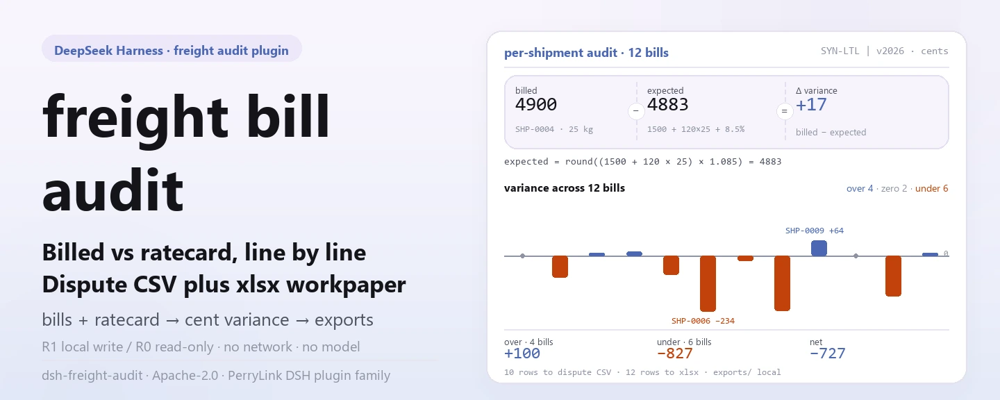

<div align="center">

<picture>
  <source media="(prefers-color-scheme: dark)" srcset="docs/assets/dsh-freight-audit-hero-en-dark.webp">
  
</picture>

# dsh-freight-audit

**Concilia las facturas de los transportistas línea a línea contra tu tarifa: mira qué se cobró de más y de menos, y exporta el archivo de disputa con la hoja de trabajo.**

Un plugin de auditoría de fletes puramente local para DeepSeek Harness: tarifas versionadas, coste esperado a partir de base + por kg × peso más un porcentaje de combustible, varianza al céntimo y una hoja de trabajo xlsx con un CSV de disputa — sin red, sin llamadas a un modelo, sin subidas.

[Instalar](#instalación-en-tres-pasos) · [Configuración](#configuración) · [FAQ](#faq) · [简体中文](README.md) · [English](README.en.md) · [Español](README.es.md) · [Português](README.pt.md) · [हिन्दी](README.hi.md)

[](LICENSE)
[](#compatibilidad)
[](https://www.npmjs.com/package/dsh-freight-audit)
[](https://github.com/PerryLink/dsh-freight-audit/actions/workflows/ci.yml)
[](#compatibilidad)

[](https://github.com/PerryLink/dsh-freight-audit/stargazers)
[](https://www.npmjs.com/package/dsh-freight-audit)
[](https://dshfind.com/plugins/PerryLink/dsh-freight-audit?ref=badge)
[](https://dsh.market/)
[](https://gitee.com/perrylink/dsh-freight-audit)

```sh
dsh plugin --profile <profile> add dsh-freight-audit
```

</div>

<sub>Plugin de la comunidad, no afiliado a DeepSeek. Repositorio canónico: <https://github.com/PerryLink/dsh-freight-audit> (Gitee es un espejo). Estado: alpha · verificado solo con datos públicos/sintéticos · no GA — sin datos ni evidencia de clientes, sin promesa de producción.</sub>

## Qué es

Una canalización local para la conciliación de fletes: `freight.ratecard` guarda una tarifa de transportista/versión en el dominio de almacenamiento local (precio base, precio por kg, porcentaje de combustible, ventana de vigencia), `freight.audit` lee un lote CSV de facturas y calcula el coste esperado por envío como `base_cents + per_kg_cents × weight_kg` más `fuel_pct`, registra la varianza en céntimos en cada factura, `freight.recovery_summary` agrega cobro excesivo/cobro insuficiente/neto, y `freight.dispute` y `freight.export` escriben el CSV de disputa y la hoja xlsx. Todo se ejecuta en tu máquina — sin red, sin llamadas a un modelo, sin subidas; las entradas las lee la sesión y se pasan a las herramientas como argumentos, y los archivos originales no se tocan.

- **Adecuado para**: facturas mensuales de fletes de decenas a miles de envíos (CSV); revisar primero la varianza y luego decidir cuánto reclamar al transportista.
- **No adecuado para**: registros manuales sin peso ni importe; integración directa con TMS / portales de transportistas (este paquete no se conecta a ningún sistema externo); sustituir una reclamación formal o un proceso legal.

<picture>
  <source media="(prefers-color-scheme: dark)" srcset="docs/assets/dsh-freight-audit-flow-v5-dark.svg">
  
</picture>

## Instalación en tres pasos

1. **Instalar** (elige un canal):

   ```sh
   # canal npm (recomendado; versiones publicadas)
   dsh plugin --profile <profile> add dsh-freight-audit
   # canal git (último main; equivalente a git+https://github.com/PerryLink/dsh-freight-audit.git)
   dsh plugin --profile <profile> add github:PerryLink/dsh-freight-audit
   # canal tarball: pnpm pack en este repo, luego
   dsh plugin --profile <profile> add ./dsh-freight-audit-<version>.tgz
   ```

2. **Configuración mínima** (el comando de instalación ya aplica el bundle patch; los perfiles escritos a mano pegan esta única fila):

   ```yaml
   - insert:
       - id: dsh-freight-audit
         name: dsh-freight-audit
   ```

   El plugin no tiene claves de configuración propias; los campos de la tarifa, las cabeceras de factura y la tabla de zonas se pasan como argumentos de la herramienta — ver «Configuración».

3. **Verificar que se monta**:

   ```sh
   dsh --profile <profile> --dump-config | grep dsh-freight-audit
   ```

   El repo incluye una muestra sintética: ejecútala una vez (debe terminar con `quickstart ok`):

   ```sh
   node samples/quickstart/run.mjs --check
   ```

Dentro de una sesión también basta con pedirlo (prompt citado de `dsh.demo` en `package.json`):

```text
我有一车承运商账单，帮我按费率卡逐票核对，把多收少收的差额和要追回的金额算出来。
```

**Desinstalar**: `dsh plugin --profile <profile> remove dsh-freight-audit` (o quita la fila del patch del perfil).

<details>
<summary>Instalar desde el mercado de DSH Desktop</summary>

Todos los plugins de PerryLink están en el mercado integrado de DSH Desktop: **Market → Sources → Add source → pega** `https://perrylink-dsh-catalog.perrylink.workers.dev/catalog-source.json` **→ selecciona**. La instalación sigue requiriendo la verificación de identidad npm del mercado y tu confirmación.

</details>

## Capacidades clave

- **Tarifas versionadas** — `freight.ratecard` con `set` guarda una tarifa y `list` las lee todas; dos versiones del mismo transportista con ventanas de vigencia solapadas se rechazan en voz alta (`E_FREIGHT_RATE_OVERLAP`), y un `effective_to` ausente significa que la versión queda abierta.
- **Auditoría y varianza por envío** — `freight.audit` analiza el CSV de facturas, calcula el coste esperado y la varianza por envío (en céntimos), escribe el resultado por envío en el dominio de almacenamiento local y devuelve la lista de envíos atípicos.
- **Resumen de recuperación** — `freight.recovery_summary` agrega cobro excesivo, cobro insuficiente y neto para un transportista/versión; solo lectura, nunca sobrescribe las facturas guardadas.
- **Exportación de disputa** — `freight.dispute` selecciona solo varianzas distintas de cero y exporta un CSV de revisión de disputa; los campos de texto se neutralizan contra inyección de fórmulas, la ruta pasa por la guardia safe-path y no se envía nada al transportista.
- **Exportación de hoja de trabajo** — `freight.export` escribe `billed/expected/variance` por envío en una sola hoja xlsx y devuelve la ruta y el número de filas.
- **Consulta de tarifa de zona** — `freight.zone_lookup` lee un CSV público de zona/tarifa y devuelve la tarifa publicada para una zona; solo lectura, nunca se suma al cálculo de auditoría.
- **Higiene de tarifas y recargos** — `freight.ratecard_validate` comprueba campos monetarios, porcentaje de combustible, ventana de vigencia y solape de versiones; `freight.accessorial_check` comprueba tipo de recargo, importe entero, duplicados, pertenencia a la lista acordada y tope total.
- **Puramente local** — sin llamadas HTTP / DNS / WebSocket en el código; sin conexiones a TMS ni a sistemas de transportistas, nada se sube.

### Superficie de herramientas

Los nombres de las herramientas son una API estable. Las herramientas que escriben archivos locales se marcan **R1 (escritura local)** y las de solo lectura **R0**. `freight.audit` escribe los resultados por envío en el dominio de almacenamiento local, así que también se marca R1.

| Herramienta | Propósito | Riesgo |
|---|---|---|
| `freight.ratecard` | Registrar/versionar una tarifa de flete; `set` escribe, `list` es de solo lectura | R1 escritura local (`set`) |
| `freight.audit` | Auditar facturas del transportista contra la tarifa; escribir esperado/varianza por envío | R1 escritura local |
| `freight.zone_lookup` | Consultar una tabla pública de zona/tarifa | R0 solo lectura |
| `freight.recovery_summary` | Resumir cobro excesivo/insuficiente/neto | R0 solo lectura |
| `freight.dispute` | Exportar un CSV de varianzas para revisión de disputa | R1 escritura local |
| `freight.export` | Exportar la hoja xlsx de auditoría | R1 escritura local |
| `freight.ratecard_validate` | Higiene de tarifas: campos monetarios, combustible, vigencia, solape | R0 solo lectura |
| `freight.accessorial_check` | Validación de recargos: tipo, importe, duplicados, lista acordada, tope | R0 solo lectura |

### Entrada y salida

Entrada:

- CSV de facturas: UTF-8, cabecera `shipment_id,weight_kg,billed`; `billed` lleva el importe (p. ej. `23.00`) y `weight_kg` es un número positivo.
- JSON de tarifa: `carrier`, `version`, `base_cents`, `per_kg_cents`, `fuel_pct`, `effective_from`, `effective_to` opcional.
- CSV de zonas: cabecera `zone,list_rate`; `list_rate` va en unidades monetarias y la herramienta lo convierte a céntimos.
- Tamaño: mantén cada lote ≤5 MB (unos 20.000 envíos); la muestra incluida tiene 12 envíos, unos 0,3 KB.
- Origen: exporta del TMS o del estado mensual del transportista y guarda como CSV; el archivo original nunca se modifica.

Salida:

- Resumen en terminal: número de facturas, facturas atípicas, varianza total, cobro excesivo/insuficiente/neto, tarifa de zona e incidencias de tarifa/recargos.
- Archivos: la hoja `xlsx` (`billed/expected/variance` por envío) y el `CSV` de disputa, bajo `$DSH_HOME/storages/dsh-freight-audit/exports/`; la factura original no se toca.
- Archivo de oro de la muestra: `samples/quickstart/expected/result.json` (producido por una ejecución real).

### Ejemplos

Muestra sintética incluida (se publica con el paquete, no son datos reales de transportistas):

```sh
node samples/quickstart/run.mjs          # resumen legible
node samples/quickstart/run.mjs --json   # resultado canónico (origen del archivo de oro)
node samples/quickstart/run.mjs --check  # compara con el oro; termina con quickstart ok
```


*La captura es la salida real de terminal de `node samples/quickstart/run.mjs --check`; el comando y los hashes de salida están en `screenshots.json` (ejecución real del 2026-11-02), y el archivo de oro es `samples/quickstart/expected/result.json`.*

Aceptación con fixture pública: repite `node scripts/acceptance.mjs`; detalle en `ACCEPTANCE.csv`:

| req_id | metric | threshold | actual | pass | source | counted |
|---|---|---|---|---|---|---|
| SKU-12-A01 | Análisis de facturas (30) | 30/30 | 30 | true | public/synthetic | false |
| SKU-12-A02 | Facturas atípicas | 5 | 5 | true | public/synthetic | false |
| SKU-12-A03 | Varianza total (céntimos) | 500 | 500 | true | public/synthetic | false |
| SKU-12-A04 | Hoja del libro de trabajo | 1 | 1 | true | public/synthetic | false |
| SKU-12-A05 | Tarifa pública de zona | 2327 | 2327 | true | public/synthetic | false |
| SKU-12-A06 | Neto de recuperación | 100 | 100 | true | public/synthetic | false |
| SKU-12-A07 | Detección de solape de tarifas | 1 | 1 | true | public/synthetic | false |
| SKU-12-A08 | Validación de recargos | 1 | 1 | true | public/synthetic | false |
| PS1-QS01 | La muestra quickstart coincide con el oro | 1/1 | 1 | true | synthetic/quickstart | true |

*Las filas SKU son comprobaciones de fixture pública/sintética (`counted=false`); PS1-QS01 es una reproducción local de la muestra incluida (`counted=true`). Ninguna es una ejecución de cliente y no se inventa salida.*

## Configuración

Este plugin no tiene claves `Config` de Schemastery — `cordis.patch.yml` solo `insert` una fila (ver «Instalación en tres pasos»), así que no hay ninguna clave de plugin que sobrescribir. Los campos de la tarifa se pasan al llamar a `freight.ratecard`:

| Campo | Tipo | Significado |
|---|---|---|
| `carrier` | string, obligatorio | Id del transportista, p. ej. `SYN-LTL` |
| `version` | string, obligatorio | Versión de la tarifa, p. ej. `v2026` |
| `base_cents` | entero no negativo (céntimos) | Precio base por envío |
| `per_kg_cents` | entero no negativo (céntimos/kg) | Precio por kilogramo |
| `fuel_pct` | número 0–100 | Porcentaje de recargo de combustible; esperado = (base + per_kg × peso) × (1 + fuel_pct/100) |
| `effective_from` | `YYYY-MM-DD` | Fecha de inicio de vigencia |
| `effective_to` | `YYYY-MM-DD`, opcional | Fecha de fin de vigencia; omitida = `9999-12-31` |

Entradas de factura y zona:

| Entrada | Cabecera | Regla |
|---|---|---|
| CSV de facturas | `shipment_id,weight_kg,billed` | Importe con dos decimales como máximo; peso positivo; una columna ausente eleva `E_FREIGHT_CSV_INVALID` |
| CSV de zonas | `zone,list_rate` | `zone` es un entero; `list_rate` va en unidades monetarias |

La ubicación de almacenamiento se puede sobrescribir con la variable de entorno `DSH_FREIGHT_HOME`; por defecto es `$DSH_HOME/storages/dsh-freight-audit`.

<details>
<summary>Valores completos: tipos de recargo y códigos de error</summary>

`freight.accessorial_check` entiende 12 tipos de recargo: `fuel`, `detention`, `liftgate`, `residential`, `inside_delivery`, `appointment`, `oversize`, `hazmat`, `waiting_time`, `reweigh`, `redelivery`, `storage`.

Los errores siguen un formato único — mensaje llano, código `E_XXX` y siguiente paso. Los códigos incluyen: `E_FREIGHT_CSV_INVALID`, `E_FREIGHT_RATE_MISSING`, `E_FREIGHT_RATE_OVERLAP`, `E_FREIGHT_EXPORT_FAILED`, `E_FREIGHT_PATH_INVALID`, `E_FREIGHT_PATH_NOT_ALLOWED`. Las herramientas de validación y recargos también devuelven `E_FREIGHT_RATE_INVALID` y códigos de incidencia `E_FREIGHT_ACCESSORIAL_*`. Síntoma/causa/acción por código: [TROUBLESHOOTING.md](TROUBLESHOOTING.md).

</details>

## FAQ

<details>
<summary>¿Dónde viven los datos? ¿Se modifican mis facturas?</summary>

Las tarifas y los resultados por envío se escriben solo en el dominio de almacenamiento local `$DSH_HOME/storages/dsh-freight-audit` (las tablas `rates` / `bills`); la hoja xlsx y el CSV de disputa van a su subdirectorio `exports/`. El CSV de entrada lo lee la sesión y se pasa a las herramientas como argumentos — la factura original nunca se modifica y no se sube nada.

</details>

<details>
<summary>No se instala, ¿qué hago?</summary>

Confirma DSH `>=0.2.1-rc.3 <0.4.0` y Node `>=24.9 <25`, y reintenta con un `DSH_HOME` nuevo; los pasos completos están en [TROUBLESHOOTING.md](TROUBLESHOOTING.md), punto 1.

</details>

<details>
<summary>Los números no cuadran, ¿qué reviso?</summary>

Primero ejecuta `node samples/quickstart/run.mjs --check`; luego comprueba que la cabecera de la factura sea exactamente `shipment_id,weight_kg,billed` y que los importes lleven dos decimales. La varianza = importe facturado − importe esperado de la tarifa, en céntimos; el esperado usa solo peso y combustible, mientras que la tarifa de zona y los recargos son herramientas de solo lectura separadas y nunca se suman al importe esperado.

</details>

<details>
<summary>¿Puede procesar mis facturas reales?</summary>

Se ejecuta en local, pero el paquete es alpha y solo está verificado con datos públicos/sintéticos — no constituye una conclusión de auditoría ni de reclamación. Anonimiza los datos reales antes de usarlos y no pegues facturas reales de transportistas en un issue.

</details>

<details>
<summary>¿Hace llamadas de red o sube datos?</summary>

No. Las herramientas, la muestra y las exportaciones se ejecutan en tu máquina; el código no contiene llamadas HTTP / DNS / WebSocket.

</details>

## Límites de seguridad

- **Sin red, sin llamadas a un modelo.** Salvo que una herramienta lo indique, no hay llamadas a modelo ni de red; la entrada y la salida permanecen locales.
- **Las facturas originales nunca se modifican.** Las escrituras solo caen en `$DSH_HOME/storages/dsh-freight-audit` (estado de tarifas/facturas y `exports/*.xlsx`, `exports/*.csv`).
- **Guardia contra path traversal en la exportación.** El nombre de archivo exportado debe coincidir con `[A-Za-z0-9._-]{1,120}`, la ruta resuelta debe quedar dentro del directorio de exportación y se re-ancla tras `realpath`; una salida fuera eleva `E_FREIGHT_PATH_INVALID` / `E_FREIGHT_PATH_NOT_ALLOWED`.
- **Guardia contra inyección de fórmulas en el CSV de disputa.** Los campos de texto que empiezan por `=`, `+`, `-` o `@` reciben un `'` delante antes de citarse/escaparse; el dinero usa campos numéricos para que una varianza negativa no se confunda con una fórmula.
- **Errores uniformes, fallos en voz alta.** Los errores siguen un formato único — mensaje llano, código `E_XXX` y siguiente paso; el detalle técnico (`detail`) se reserva para el log y nunca se incorpora al mensaje visible.
- **Solo datos públicos/sintéticos.** El repositorio no contiene datos ni evidencia de clientes; cada fila de aceptación declara su origen y su estado `counted`.

## Permisos y datos

- **Lee**: los CSV de facturas de flete, el JSON de tarifa y la tabla de tarifas de zona que indiques; ningún otro directorio.
- **Escribe**: `$DSH_HOME/storages/dsh-freight-audit` (estado de tarifas y facturas por envío, `exports/*.xlsx`, `exports/*.csv`); la factura original intacta.
- **Red**: no (sin llamadas HTTP / DNS / WebSocket en el código).
- **Sistemas externos**: ninguno (sin conexiones a TMS ni a sistemas de transportistas, sin subidas).
- **Frontera de datos**: verificado solo con muestras públicas/sintéticas; sin datos ni evidencia de clientes.
- **Mantenimiento activo**: las nuevas funciones y el endurecimiento llegan en versiones alpha.

## Limitaciones conocidas

- **Verificado solo con datos públicos/sintéticos.** `EVIDENCE.md` registra 0 transportistas reales, 30 facturas sintéticas y 4 filas aprobadas; las filas SKU de `ACCEPTANCE.csv` son `counted=false`, y PS1-QS01 es una reproducción local de la muestra con `counted=true`.
- **Alpha / parcial / no contabilizado / no GA.** Sin promesa de producción; no constituye una conclusión de auditoría, reclamación ni pago.
- **Solo conciliación local, sin envío de reclamaciones.** No se conecta a portales de transportistas, no envía el archivo de disputa y no sustituye una reclamación formal ni un proceso legal.
- **Restricciones de formato de entrada.** La cabecera de la factura debe coincidir literalmente (una columna ausente eleva `E_FREIGHT_CSV_INVALID`); los importes llevan como máximo dos decimales; el peso debe ser positivo; cada lote ≤5 MB.
- **La fórmula de auditoría usa solo peso y combustible.** Esperado = (base + per_kg × peso) × (1 + fuel_pct/100); la tarifa de zona y los recargos son herramientas de solo lectura separadas y no se suman al importe esperado.
- **Los límites exactos por herramienta** son la tabla de herramientas de arriba más `ACCEPTANCE.csv`.

## Compatibilidad

| Superficie | Estado |
|---|---|
| Harness | DeepSeek Harness `>=0.2.1-rc.3 <0.4.0` (`engines.dsh` en `package.json`) |
| Node | `>=24.9.0 <25` (`.nvmrc`: 24) |
| Plataformas | Dondequiera que DSH se ejecute; solo archivos locales |
| Datos | Sin red, sin llamadas a un modelo, sin subidas |

## Ecosistema y calidad

- [Espejo en Gitee](https://gitee.com/perrylink/dsh-freight-audit) (espejo sincronizado; GitHub es el canónico)
- [Página del plugin en dshfind](https://dshfind.com/plugins/PerryLink/dsh-freight-audit) (instalaciones y ranking)
- [DSH Market](https://dsh.market/) (listado)
- **Canal de la tienda 1024**: `npm i -g dsh1024` una vez, luego `dsh1024 plugin --profile <profile> add dsh-freight-audit` (cuenta en el ranking de instalaciones de [deepseek1024.com](https://deepseek1024.com))
- [Índice de dominio](https://perrylink.github.io/dsh-plugins/) · [Familia de checkers](https://perrylink.github.io/zh/checkers/)

### Trabajo relacionado y checkers

Paquetes hermanos e índices de la familia: [dsh-hs-candidate](https://github.com/PerryLink/dsh-hs-candidate) · [dsh-pim-lint](https://github.com/PerryLink/dsh-pim-lint)

Cada checker es un paquete independiente con su propio paquete de reglas y versión; instala solo los que necesites:

| Paquete | Por qué es relevante |
|---|---|
| [`dsh-demurrage-ledger`](https://github.com/PerryLink/dsh-demurrage-ledger) | Integridad y aritmética del libro de demoras/detenciones |
| [`dsh-lc-doc-check`](https://github.com/PerryLink/dsh-lc-doc-check) | Lista de presentación y fechas de la carta de crédito |
| [`dsh-customs-doc-check`](https://github.com/PerryLink/dsh-customs-doc-check) | Consistencia de los documentos de declaración aduanera |

## Desarrollo

```sh
pnpm install --frozen-lockfile                            # node >=24.9 <25
pnpm build && pnpm lint && pnpm typecheck && pnpm test    # build tsc + lint + 28 casos node --test
pnpm gate:sku12                                           # puerta de aceptación (ACCEPTANCE.csv)
node scripts/acceptance.mjs                               # repetir la aceptación pública/sintética
node samples/quickstart/run.mjs --check                   # muestra sintética; debe imprimir quickstart ok
```

Versión actual `0.1.1` (coincide con `package.json`). Pruebas: `node --test test/*.test.mjs` (9 archivos de prueba, 28 casos; `pnpm test` compila primero). Las imágenes del README se generan programáticamente con [`scripts/gen-readme-assets.py`](scripts/gen-readme-assets.py) (Python/Pillow para el hero bilingüe 1440×576 claro/oscuro y SVG escrito a mano para el par de estructura 1100×660 claro/oscuro compartido por los cinco idiomas) y se pueden repetir: `python scripts/gen-readme-assets.py`.

Topics: `deepseek-harness`, `dsh`, `dsh-plugin`, `freight`, `audit`, `logistics`, `perrylink`, `ratecard`

## Familia y agradecimientos

Este proyecto forma parte de la familia de plugins de DeepSeek Harness de [PerryLink](https://github.com/PerryLink) (todos Apache-2.0). Si te resulta útil, **una estrella ayuda a que la siguiente persona lo encuentre** — no hay nada bloqueado tras ella.

- [@PerryLink](https://github.com/PerryLink) — creador y mantenedor: el motor de versionado de tarifas y auditoría por envío, las ocho herramientas `freight.*`, la muestra quickstart y la suite de aceptación, y la documentación en cinco idiomas.

## Licencia

[LICENSE](LICENSE) (Apache License 2.0) © 2026 dsh-freight-audit contributors; ver también `NOTICE` y `THIRD-PARTY-NOTICES`.

<p align="center"><sub>Apache-2.0 · Plugin de la comunidad, no afiliado a DeepSeek.</sub></p>
