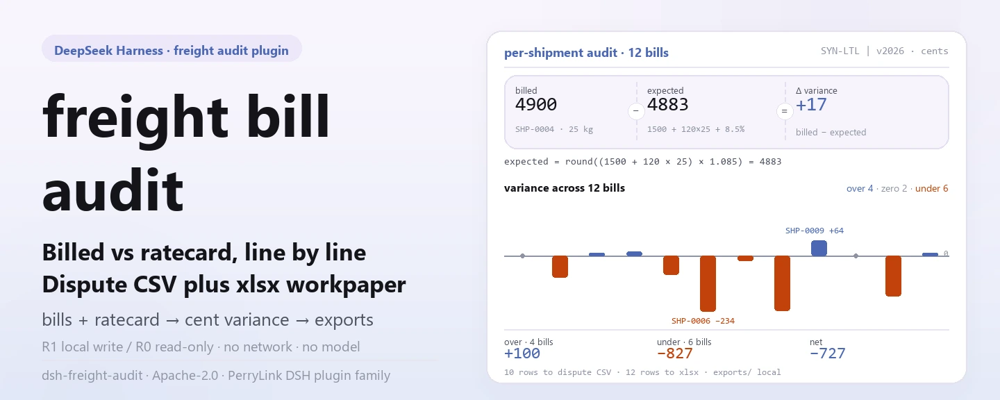

<div align="center">

<picture>
  <source media="(prefers-color-scheme: dark)" srcset="docs/assets/dsh-freight-audit-hero-en-dark.webp">
  
</picture>

# dsh-freight-audit

**कैरियर बिलों को रेटकार्ड से पंक्ति-दर-पंक्ति मिलाएँ — कितना अधिक और कितना कम लिया गया, देखें और विवाद CSV के साथ वर्कपेपर निर्यात करें।**

DeepSeek Harness के लिए पूरी तरह स्थानीय फ़्रेट ऑडिट प्लगइन: वर्ज़न वाले रेटकार्ड, base + per-kg × वज़न पर फ़्यूल प्रतिशत जोड़कर अपेक्षित लागत, सेंट-स्तर का अंतर, और विवाद CSV के साथ xlsx वर्कपेपर — न नेटवर्क, न मॉडल कॉल, न अपलोड।

[इंस्टॉल](#तीन-चरणों-में-शुरुआत) · [कॉन्फ़िगरेशन](#कॉन्फ़िगरेशन) · [FAQ](#faq) · [简体中文](README.md) · [English](README.en.md) · [Español](README.es.md) · [Português](README.pt.md) · [हिन्दी](README.hi.md)

[](LICENSE)
[](#संगतता)
[](https://www.npmjs.com/package/dsh-freight-audit)
[](https://github.com/PerryLink/dsh-freight-audit/actions/workflows/ci.yml)
[](#संगतता)

[](https://github.com/PerryLink/dsh-freight-audit/stargazers)
[](https://www.npmjs.com/package/dsh-freight-audit)
[](https://dshfind.com/plugins/PerryLink/dsh-freight-audit?ref=badge)
[](https://dsh.market/)
[](https://gitee.com/perrylink/dsh-freight-audit)

```sh
dsh plugin --profile <profile> add dsh-freight-audit
```

</div>

<sub>समुदाय प्लगइन, DeepSeek से संबद्ध नहीं। कैनोनिकल रेपो: <https://github.com/PerryLink/dsh-freight-audit> (Gitee एक मिरर है)। स्थिति: alpha · केवल सार्वजनिक/सिंथेटिक डेटा पर सत्यापित · GA नहीं — कोई ग्राहक डेटा या ग्राहक साक्ष्य नहीं, उत्पादन-तैयारी का दावा नहीं।</sub>

## यह क्या है

फ़्रेट मिलान की स्थानीय पाइपलाइन: `freight_ratecard` किसी कैरियर/वर्ज़न का रेटकार्ड स्थानीय स्टोरेज डोमेन में रखता है (बेस कीमत, प्रति-किलो कीमत, फ़्यूल प्रतिशत, प्रभावी अवधि), `freight_audit` बिलों का CSV बैच पढ़ता है और हर शिपमेंट की अपेक्षित लागत `base_cents + per_kg_cents × weight_kg` में `fuel_pct` जोड़कर निकालता है, अंतर सेंट में हर बिल पर दर्ज करता है, `freight_recovery_summary` अधिक वसूली/कम वसूली/नेट जोड़ता है, और `freight_dispute` तथा `freight_export` क्रमशः विवाद CSV और xlsx वर्कपेपर लिखते हैं। सारी गणना आपकी मशीन पर होती है — न नेटवर्क, न मॉडल कॉल, न अपलोड; इनपुट सत्र द्वारा पढ़कर टूलों को तर्क के रूप में दिए जाते हैं, और मूल फ़ाइलें नहीं छूई जातीं।

- **किसके लिए उपयुक्त**: कुछ दर्जन से हज़ारों शिपमेंट वाले मासिक फ़्रेट बिल (CSV); पहले अंतर देखें, फिर तय करें कि कैरियर से कितना वसूलना है।
- **किसके लिए नहीं**: बिना वज़न या राशि वाले हाथ के रिकॉर्ड; सीधा TMS / कैरियर पोर्टल इंटीग्रेशन (यह पैकेज किसी बाहरी सिस्टम से नहीं जुड़ता); औपचारिक दावे या कानूनी प्रक्रिया की जगह लेना।

<picture>
  <source media="(prefers-color-scheme: dark)" srcset="docs/assets/dsh-freight-audit-flow-v5-dark.svg">
  
</picture>

## तीन चरणों में शुरुआत

1. **इंस्टॉल करें** (एक चैनल चुनें):

   ```sh
   # npm चैनल (अनुशंसित; प्रकाशित वर्ज़न)
   dsh plugin --profile <profile> add dsh-freight-audit
   # git चैनल (नवीनतम main; git+https://github.com/PerryLink/dsh-freight-audit.git के समतुल्य)
   dsh plugin --profile <profile> add github:PerryLink/dsh-freight-audit
   # tarball चैनल: इस रेपो में pnpm pack करके
   dsh plugin --profile <profile> add ./dsh-freight-audit-<version>.tgz
   ```

2. **न्यूनतम कॉन्फ़िगरेशन** (इंस्टॉल कमांड bundle patch पहले ही लागू कर देती है; हाथ से लिखे प्रोफ़ाइल यह एक पंक्ति चिपकाएँ):

   ```yaml
   - insert:
       - id: dsh-freight-audit
         name: dsh-freight-audit
   ```

   इस प्लगइन में कोई प्लगइन-स्तरीय कॉन्फ़िगरेशन कुंजी नहीं है; रेटकार्ड फ़ील्ड, बिल हेडर और ज़ोन तालिका टूल तर्कों के रूप में दी जाती है — «कॉन्फ़िगरेशन» देखें।

3. **माउंट होने की पुष्टि करें**:

   ```sh
   dsh --profile <profile> --dump-config | grep dsh-freight-audit
   ```

   रेपो में सिंथेटिक नमूना शामिल है — इसे एक बार चलाएँ (अंत में `quickstart ok` आना चाहिए):

   ```sh
   node samples/quickstart/run.mjs --check
   ```

सत्र के अंदर सीधे कहना भी काफी है (प्रॉम्प्ट `package.json` के `dsh.demo` से उदृत):

```text
我有一车承运商账单，帮我按费率卡逐票核对，把多收少收的差额和要追回的金额算出来。
```

**अनइंस्टॉल**: `dsh plugin --profile <profile> remove dsh-freight-audit` (या प्रोफ़ाइल पैच से वह पंक्ति हटाएँ)।

<details>
<summary>DSH Desktop मार्केट से इंस्टॉल करें</summary>

सभी PerryLink प्लगइन DSH Desktop के अंतर्निहित मार्केट में ब्राउज़ किए जा सकते हैं: **Market → Sources → Add source → पेस्ट करें** `https://perrylink-dsh-catalog.perrylink.workers.dev/catalog-source.json` **→ चुनें**। इंस्टॉलेशन के लिए मार्केट की npm पहचान जाँच और आपकी पुष्टि आवश्यक रहती है।

</details>

## मुख्य क्षमताएँ

- **वर्ज़न वाले रेटकार्ड** — `freight_ratecard` का `set` एक रेटकार्ड सहेजता है और `list` सब पढ़ता है; एक ही कैरियर के दो वर्ज़न की प्रभावी अवधि ओवरलैप होने पर स्पष्ट रूप से अस्वीकार होती है (`E_FREIGHT_RATE_OVERLAP`), और `effective_to` न देने का अर्थ है वर्ज़न खुला है।
- **प्रति-शिपमेंट ऑडिट और अंतर** — `freight_audit` बिल CSV पार्स करता है, हर शिपमेंट की अपेक्षित लागत और अंतर (सेंट में) निकालता है, प्रति-शिपमेंट परिणाम स्थानीय स्टोरेज डोमेन में लिखता है और अपवाद शिपमेंट आईडी की सूची लौटाता है।
- **रिकवरी सारांश** — `freight_recovery_summary` किसी कैरियर/वर्ज़न के लिए अधिक वसूली, कम वसूली और नेट जोड़ता है; रीड-ओनली, सहेजे बिलों को कभी अधिलेखित नहीं करता।
- **विवाद निर्यात** — `freight_dispute` केवल गैर-शून्य अंतर वाले बिल चुनकर विवाद-समीक्षा CSV निर्यात करता है; टेक्स्ट फ़ील्ड फ़ॉर्मूला इंजेक्शन के विरुद्ध निष्क्रिय किए जाते हैं, पथ safe-path गार्ड से गुजरता है, और कैरियर को कुछ नहीं भेजा जाता।
- **वर्कपेपर निर्यात** — `freight_export` प्रति-शिपमेंट `billed/expected/variance` को एक xlsx शीट में लिखता है और पथ तथा पंक्ति संख्या लौटाता है।
- **ज़ोन सूची-दर खोज** — `freight_zone_lookup` सार्वजनिक ज़ोन/दर CSV पढ़कर किसी ज़ोन की प्रकाशित दर लौटाता है; रीड-ओनली, ऑडिट गणना में कभी नहीं जोड़ा जाता।
- **रेटकार्ड और एक्सेसोरियल जाँच** — `freight_ratecard_validate` राशि फ़ील्ड, फ़्यूल अनुपात, प्रभावी अवधि और वर्ज़न ओवरलैप जाँचता है; `freight_accessorial_check` एक्सेसोरियल प्रकार, पूर्णांक राशि, डुप्लिकेट, सहमत सूची और कुल सीमा जाँचता है।
- **पूरी तरह स्थानीय** — स्रोत में कोई HTTP / DNS / WebSocket कॉल नहीं; न TMS न कैरियर सिस्टम से कनेक्शन, कुछ भी अपलोड नहीं।

### टूल सतह

टूल नाम स्थिर API हैं। स्थानीय फ़ाइलें लिखने वाले टूल **R1 (स्थानीय लेखन)**, रीड-ओनली टूल **R0** चिह्नित हैं। `freight_audit` प्रति-शिपमेंट परिणाम स्थानीय स्टोरेज डोमेन में लिखता है, इसलिए वह भी R1 है।

| टूल | उद्देश्य | जोखिम |
|---|---|---|
| `freight_ratecard` | फ़्रेट रेटकार्ड पंजीकृत/वर्ज़न करें; `set` लिखता है, `list` रीड-ओनली है | R1 स्थानीय लेखन (`set`) |
| `freight_audit` | कैरियर बिलों को रेटकार्ड के विरुद्ध ऑडिट करें; प्रति-शिपमेंट अपेक्षित/अंतर लिखें | R1 स्थानीय लेखन |
| `freight_zone_lookup` | सार्वजनिक ज़ोन/दर तालिका खोजें | R0 रीड-ओनली |
| `freight_recovery_summary` | अधिक/कम/नेट रिकवरी का सारांश | R0 रीड-ओनली |
| `freight_dispute` | विवाद समीक्षा के लिए अंतर CSV निर्यात करें | R1 स्थानीय लेखन |
| `freight_export` | ऑडिट xlsx वर्कपेपर निर्यात करें | R1 स्थानीय लेखन |
| `freight_ratecard_validate` | रेटकार्ड जाँच: राशि, फ़्यूल, अवधि, वर्ज़न ओवरलैप | R0 रीड-ओनली |
| `freight_accessorial_check` | एक्सेसोरियल सत्यापन: प्रकार, राशि, डुप्लिकेट, सहमत सूची, कुल सीमा | R0 रीड-ओनली |

### इनपुट और आउटपुट

इनपुट:

- बिल CSV: UTF-8, हेडर `shipment_id,weight_kg,billed`; `billed` में राशि (जैसे `23.00`) और `weight_kg` में धनात्मक संख्या।
- रेटकार्ड JSON: `carrier`, `version`, `base_cents`, `per_kg_cents`, `fuel_pct`, `effective_from`, वैकल्पिक `effective_to`।
- ज़ोन CSV: हेडर `zone,list_rate`; `list_rate` मुद्रा इकाइयों में है और टूल उसे सेंट में बदलता है।
- आकार: हर बैच ≤5 MB रखें (लगभग 20,000 शिपमेंट); साथ दिया नमूना 12 शिपमेंट का है, लगभग 0.3 KB।
- स्रोत: TMS या कैरियर के मासिक स्टेटमेंट से निर्यात करके CSV के रूप में सहेजें; मूल फ़ाइल कभी नहीं बदलती।

आउटपुट:

- टर्मिनल सारांश: बिल संख्या, अपवाद बिल, कुल अंतर, अधिक/कम/नेट वसूली, ज़ोन सूची-दर, और रेटकार्ड/एक्सेसोरियल समस्याएँ।
- फ़ाइलें: `xlsx` वर्कपेपर (प्रति-शिपमेंट `billed/expected/variance`) और विवाद `CSV`, `$DSH_HOME/storages/dsh-freight-audit/exports/` के अंतर्गत; मूल बिल अछूता।
- नमूना गोल्ड फ़ाइल: `samples/quickstart/expected/result.json` (वास्तविक रन से बनी)।

### उदाहरण

साथ दिया सिंथेटिक नमूना (पैकेज के साथ प्रकाशित, वास्तविक कैरियर डेटा नहीं):

```sh
node samples/quickstart/run.mjs          # पढ़ने योग्य सारांश
node samples/quickstart/run.mjs --json   # कैनोनिकल परिणाम (गोल्ड फ़ाइल का स्रोत)
node samples/quickstart/run.mjs --check  # गोल्ड से तुलना; अंत में quickstart ok
```


*स्क्रीनशॉट `node samples/quickstart/run.mjs --check` का वास्तविक टर्मिनल आउटपुट है; कमांड और आउटपुट हैश `screenshots.json` में दर्ज हैं (2026-11-02 का वास्तविक रन), और गोल्ड फ़ाइल `samples/quickstart/expected/result.json` है।*

सार्वजनिक fixture स्वीकृति: `node scripts/acceptance.mjs` दोबारा चलाएँ; विवरण `ACCEPTANCE.csv` में:

| req_id | metric | threshold | actual | pass | source | counted |
|---|---|---|---|---|---|---|
| SKU-12-A01 | बिल पार्सिंग (30) | 30/30 | 30 | true | public/synthetic | false |
| SKU-12-A02 | अपवाद बिल | 5 | 5 | true | public/synthetic | false |
| SKU-12-A03 | कुल अंतर (सेंट) | 500 | 500 | true | public/synthetic | false |
| SKU-12-A04 | वर्कपेपर शीट | 1 | 1 | true | public/synthetic | false |
| SKU-12-A05 | सार्वजनिक ज़ोन दर | 2327 | 2327 | true | public/synthetic | false |
| SKU-12-A06 | रिकवरी नेट | 100 | 100 | true | public/synthetic | false |
| SKU-12-A07 | रेटकार्ड ओवरलैप पहचान | 1 | 1 | true | public/synthetic | false |
| SKU-12-A08 | एक्सेसोरियल सत्यापन | 1 | 1 | true | public/synthetic | false |
| PS1-QS01 | quickstart नमूना गोल्ड से मेल | 1/1 | 1 | true | synthetic/quickstart | true |

*SKU पंक्तियाँ सार्वजनिक/सिंथेटिक fixture जाँच हैं (`counted=false`); PS1-QS01 साथ दिए नमूने की स्थानीय पुनरावृत्ति है (`counted=true`)। कोई भी ग्राहक रन नहीं है और कोई आउटपुट नहीं गढ़ा गया।*

## कॉन्फ़िगरेशन

इस प्लगइन में कोई Schemastery `Config` कुंजी नहीं है — `cordis.patch.yml` केवल एक पंक्ति `insert` करता है (देखें «तीन चरणों में शुरुआत»), इसलिए ओवरराइड करने योग्य कोई प्लगइन-स्तरीय कुंजी नहीं है। रेटकार्ड फ़ील्ड `freight_ratecard` कॉल करते समय दिए जाते हैं:

| फ़ील्ड | प्रकार | अर्थ |
|---|---|---|
| `carrier` | string, आवश्यक | कैरियर आईडी, जैसे `SYN-LTL` |
| `version` | string, आवश्यक | रेटकार्ड वर्ज़न, जैसे `v2026` |
| `base_cents` | गैर-ऋणात्मक पूर्णांक (सेंट) | प्रति शिपमेंट बेस कीमत |
| `per_kg_cents` | गैर-ऋणात्मक पूर्णांक (सेंट/किग्रा) | प्रति किलोग्राम कीमत |
| `fuel_pct` | 0–100 संख्या | फ़्यूल अधिभार प्रतिशत; अपेक्षित = (base + per_kg × वज़न) × (1 + fuel_pct/100) |
| `effective_from` | `YYYY-MM-DD` | प्रभावी आरंभ तिथि |
| `effective_to` | `YYYY-MM-DD`, वैकल्पिक | प्रभावी अंत तिथि; न देने पर = `9999-12-31` |

बिल और ज़ोन इनपुट:

| इनपुट | हेडर | नियम |
|---|---|---|
| बिल CSV | `shipment_id,weight_kg,billed` | राशि में अधिकतम दो दशमलव; वज़न धनात्मक; कॉलम गायब होने पर `E_FREIGHT_CSV_INVALID` |
| ज़ोन CSV | `zone,list_rate` | `zone` पूर्णांक; `list_rate` मुद्रा इकाइयों में |

स्टोरेज स्थान `DSH_FREIGHT_HOME` पर्यावरण चर से बदला जा सकता है; डिफ़ॉल्ट `$DSH_HOME/storages/dsh-freight-audit` है।

<details>
<summary>पूर्ण मान: एक्सेसोरियल प्रकार और त्रुटि कोड</summary>

`freight_accessorial_check` 12 एक्सेसोरियल प्रकार समझता है: `fuel`, `detention`, `liftgate`, `residential`, `inside_delivery`, `appointment`, `oversize`, `hazmat`, `waiting_time`, `reweigh`, `redelivery`, `storage`.

त्रुटियाँ एक ही प्रारूप में हैं — सरल संदेश, `E_XXX` कोड और अगला कदम। त्रुटि कोड में शामिल हैं: `E_FREIGHT_CSV_INVALID`, `E_FREIGHT_RATE_MISSING`, `E_FREIGHT_RATE_OVERLAP`, `E_FREIGHT_EXPORT_FAILED`, `E_FREIGHT_PATH_INVALID`, `E_FREIGHT_PATH_NOT_ALLOWED`. वैलिडेटर और एक्सेसोरियल टूल `E_FREIGHT_RATE_INVALID` तथा `E_FREIGHT_ACCESSORIAL_*` समस्या कोड भी लौटाते हैं। प्रति कोड लक्षण/कारण/क्रिया: [TROUBLESHOOTING.md](TROUBLESHOOTING.md)।

</details>

## FAQ

<details>
<summary>डेटा कहाँ रहता है? मेरे बिल बदलते हैं क्या?</summary>

रेटकार्ड और प्रति-शिपमेंट परिणाम केवल स्थानीय स्टोरेज डोमेन `$DSH_HOME/storages/dsh-freight-audit` (की `rates` / `bills` तालिकाओं) में लिखे जाते हैं; xlsx वर्कपेपर और विवाद CSV इसकी `exports/` उपनिर्देशिका में जाते हैं। इनपुट CSV सत्र द्वारा पढ़कर टूलों को तर्क के रूप में दिया जाता है — मूल बिल कभी नहीं बदलता और कुछ भी अपलोड नहीं होता।

</details>

<details>
<summary>इंस्टॉल नहीं हो रहा, क्या करें?</summary>

DSH `>=0.2.1-rc.3 <0.4.0` और Node `>=24.9 <25` की पुष्टि करें, फिर नए `DSH_HOME` के साथ दोबारा कोशिश करें; पूरे चरण [TROUBLESHOOTING.md](TROUBLESHOOTING.md) के आइटम 1 में हैं।

</details>

<details>
<summary>संख्याएँ मेल नहीं खा रहीं, क्या जाँचें?</summary>

पहले `node samples/quickstart/run.mjs --check` चलाएँ; फिर देखें कि बिल हेडर ठीक `shipment_id,weight_kg,billed` है और राशियों में दो दशमलव हैं। अंतर = बिल राशि − रेटकार्ड अपेक्षित राशि, सेंट में; अपेक्षित केवल वज़न और फ़्यूल से बनता है, जबकि ज़ोन सूची-दर और एक्सेसोरियल अलग रीड-ओनली टूल हैं और अपेक्षित राशि में कभी नहीं जुड़ते।

</details>

<details>
<summary>क्या यह मेरे वास्तविक बिल संभाल सकता है?</summary>

यह स्थानीय रूप से चलता है, लेकिन पैकेज alpha है और केवल सार्वजनिक/सिंथेटिक डेटा पर सत्यापित है — यह ऑडिट या दावे का निष्कर्ष नहीं है। वास्तविक डेटा इस्तेमाल से पहले अनाम करें, और वास्तविक कैरियर बिल issue में न चिपकाएँ।

</details>

<details>
<summary>क्या यह नेटवर्क कॉल करता है या डेटा अपलोड करता है?</summary>

नहीं। टूल, नमूना और निर्यात सब आपकी मशीन पर चलते हैं; स्रोत में कोई HTTP / DNS / WebSocket कॉल नहीं है।

</details>

## सुरक्षा सीमाएँ

- **न नेटवर्क, न मॉडल कॉल।** जब तक कोई टूल स्पष्ट रूप से न कहे, कोई मॉडल या नेटवर्क कॉल नहीं होता; इनपुट और आउटपुट स्थानीय रहते हैं।
- **मूल बिल कभी नहीं बदलते।** लेखन केवल `$DSH_HOME/storages/dsh-freight-audit` (रेटकार्ड/बिल स्थिति तथा `exports/*.xlsx`, `exports/*.csv`) में होता है।
- **निर्यात पर पाथ ट्रैवर्सल गार्ड।** निर्यात फ़ाइल नाम `[A-Za-z0-9._-]{1,120}` से मेल खाना चाहिए, हल किया गया पथ निर्यात निर्देशिका के भीतर रहना चाहिए, और `realpath` के बाद फिर से एंकर किया जाता है; बाहर निकलने पर `E_FREIGHT_PATH_INVALID` / `E_FREIGHT_PATH_NOT_ALLOWED`।
- **विवाद CSV पर फ़ॉर्मूला इंजेक्शन गार्ड।** `=`, `+`, `-` या `@` से शुरू होने वाले टेक्स्ट फ़ील्ड से पहले `'` लगाया जाता है, फिर ज़रूरत पर उद्धरण/एस्केप; राशि संख्या फ़ील्ड में रहती है ताकि ऋणात्मक अंतर फ़ॉर्मूला न समझा जाए।
- **एकरूप त्रुटियाँ, स्पष्ट विफलता।** त्रुटियाँ एक ही प्रारूप में हैं — सरल संदेश, `E_XXX` कोड और अगला कदम; तकनीकी `detail` केवल लॉग के लिए रहता है और उपयोगकर्ता-दृश्य संदेश में कभी नहीं जुड़ता।
- **केवल सार्वजनिक/सिंथेटिक डेटा।** रेपो में कोई ग्राहक डेटा या ग्राहक साक्ष्य नहीं है; हर स्वीकृति पंक्ति अपना स्रोत और `counted` स्थिति बताती है।

## अनुमतियाँ और डेटा

- **पढ़ता है**: आपके बताए फ़्रेट बिल CSV, रेटकार्ड JSON और ज़ोन दर तालिका; कोई अन्य निर्देशिका नहीं।
- **लिखता है**: `$DSH_HOME/storages/dsh-freight-audit` (रेटकार्ड और प्रति-शिपमेंट बिल स्थिति, `exports/*.xlsx`, `exports/*.csv`); मूल बिल अछूता।
- **नेटवर्क**: नहीं (स्रोत में कोई HTTP / DNS / WebSocket कॉल नहीं)।
- **बाहरी सिस्टम**: कोई नहीं (न TMS न कैरियर सिस्टम से कनेक्शन, कोई अपलोड नहीं)।
- **डेटा सीमा**: केवल सार्वजनिक/सिंथेटिक नमूनों पर सत्यापित; कोई ग्राहक डेटा या ग्राहक साक्ष्य नहीं।
- **सक्रिय रूप से अनुरक्षित**: नई सुविधाएँ और हार्डनिंग alpha रिलीज़ में आती हैं।

## ज्ञात सीमाएँ

- **केवल सार्वजनिक/सिंथेटिक डेटा पर सत्यापित।** `EVIDENCE.md` में 0 वास्तविक कैरियर, 30 सिंथेटिक बिल और 4 पास पंक्तियाँ दर्ज हैं; `ACCEPTANCE.csv` की SKU पंक्तियाँ `counted=false` हैं, और PS1-QS01 नमूने की स्थानीय पुनरावृत्ति है जिसमें `counted=true` है।
- **Alpha / आंशिक / गिना नहीं गया / GA नहीं।** उत्पादन-तैयारी का दावा नहीं; ऑडिट, दावे या भुगतान का निष्कर्ष नहीं।
- **केवल स्थानीय मिलान, दावा प्रस्तुति नहीं।** कैरियर पोर्टल से नहीं जुड़ता, विवाद फ़ाइल नहीं भेजता, और औपचारिक दावे या कानूनी प्रक्रिया की जगह नहीं लेता।
- **इनपुट प्रारूप प्रतिबंध।** बिल हेडर शब्दशः मेल खाना चाहिए (कॉलम गायब होने पर `E_FREIGHT_CSV_INVALID`); राशि में अधिकतम दो दशमलव; वज़न धनात्मक; हर बैच ≤5 MB।
- **ऑडिट सूत्र केवल वज़न और फ़्यूल इस्तेमाल करता है।** अपेक्षित = (base + per_kg × वज़न) × (1 + fuel_pct/100); ज़ोन सूची-दर और एक्सेसोरियल अलग रीड-ओनली टूल हैं और अपेक्षित राशि में नहीं जुड़ते।
- **प्रति-टूल सटीक सीमाएँ** ऊपर की टूल तालिका और `ACCEPTANCE.csv` हैं।

## संगतता

| सतह | स्थिति |
|---|---|
| Harness | DeepSeek Harness `>=0.2.1-rc.3 <0.4.0` (`package.json` में `engines.dsh`) |
| Node | `>=24.9.0 <25` (`.nvmrc`: 24) |
| प्लेटफ़ॉर्म | जहाँ DSH चलता है; केवल स्थानीय फ़ाइलें |
| डेटा | न नेटवर्क, न मॉडल कॉल, न अपलोड |

## इकोसिस्टम और गुणवत्ता

- [Gitee मिरर](https://gitee.com/perrylink/dsh-freight-audit) (सिंक मिरर; कैनोनिकल GitHub है)
- [dshfind प्लगइन पेज](https://dshfind.com/plugins/PerryLink/dsh-freight-audit) (इंस्टॉल और रैंकिंग)
- [DSH Market](https://dsh.market/) (सूचीबद्ध)
- **1024 स्टोर चैनल**: एक बार `npm i -g dsh1024`, फिर `dsh1024 plugin --profile <profile> add dsh-freight-audit` ([deepseek1024.com](https://deepseek1024.com) की इंस्टॉल रैंकिंग में गिना जाता है)
- [डोमेन इंडेक्स](https://perrylink.github.io/dsh-plugins/) · [चेकर परिवार](https://perrylink.github.io/zh/checkers/)

### संबंधित कार्य और चेकर

सहोदर पैकेज और परिवार इंडेक्स: [dsh-hs-candidate](https://github.com/PerryLink/dsh-hs-candidate) · [dsh-pim-lint](https://github.com/PerryLink/dsh-pim-lint)

हर चेकर अलग पैकेज है, अपने नियम पैक और वर्ज़न के साथ; केवल ज़रूरत वाले इंस्टॉल करें:

| पैकेज | यह क्यों प्रासंगिक है |
|---|---|
| [`dsh-demurrage-ledger`](https://github.com/PerryLink/dsh-demurrage-ledger) | डेमरेज/डिटेंशन लेजर की पूर्णता और अंकगणित |
| [`dsh-lc-doc-check`](https://github.com/PerryLink/dsh-lc-doc-check) | लेटर-ऑफ़-क्रेडिट प्रस्तुति सूची और तिथियाँ |
| [`dsh-customs-doc-check`](https://github.com/PerryLink/dsh-customs-doc-check) | सीमा शुल्क घोषणा दस्तावेज़ों की संगति |

## विकास

```sh
pnpm install --frozen-lockfile                            # node >=24.9 <25
pnpm build && pnpm lint && pnpm typecheck && pnpm test    # tsc बिल्ड + lint + 28 node --test केस
pnpm gate:sku12                                           # स्वीकृति गेट (ACCEPTANCE.csv)
node scripts/acceptance.mjs                               # सार्वजनिक/सिंथेटिक स्वीकृति दोबारा चलाएँ
node samples/quickstart/run.mjs --check                   # सिंथेटिक नमूना; quickstart ok छापना चाहिए
```

मौजूदा वर्ज़न `0.2.0` (`package.json` से मेल)। परीक्षण: `node --test test/*.test.mjs` (10 परीक्षण फ़ाइलें, 29 केस; `pnpm test` पहले बिल्ड करता है)। README की छवियाँ [`scripts/gen-readme-assets.py`](scripts/gen-readme-assets.py) से प्रोग्रामेटिक रूप से बनती हैं (Python/Pillow से 1440×576 द्विभाषी हल्का/गहरा hero webp और हाथ से लिखा SVG 1100×660 हल्का/गहरा संरचना जोड़ी, पाँचों भाषाओं में साझा) और दोबारा चलाई जा सकती हैं: `python scripts/gen-readme-assets.py`.

Topics: `deepseek-harness`, `dsh`, `dsh-plugin`, `freight`, `audit`, `logistics`, `perrylink`, `ratecard`

## परिवार और आभार

यह प्रोजेक्ट [PerryLink](https://github.com/PerryLink) के DeepSeek Harness प्लगइन परिवार का सदस्य है (सभी Apache-2.0)। अगर यह उपयोगी हो, **एक स्टार अगली व्यक्ति को इसे खोजने में मदद करता है** — इसके पीछे कुछ भी बंद नहीं है।

- [@PerryLink](https://github.com/PerryLink) — निर्माता और अनुरक्षक: रेटकार्ड वर्ज़निंग और प्रति-शिपमेंट ऑडिट इंजन, आठ `freight_*` टूल, quickstart नमूना और स्वीकृति सूट, तथा पाँच-भाषा दस्तावेज़।

## लाइसेंस

[LICENSE](LICENSE) (Apache License 2.0) © 2026 dsh-freight-audit contributors; `NOTICE` और `THIRD-PARTY-NOTICES` भी देखें।

<p align="center"><sub>Apache-2.0 · समुदाय प्लगइन, DeepSeek से संबद्ध नहीं।</sub></p>
