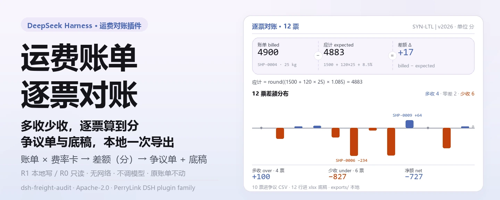
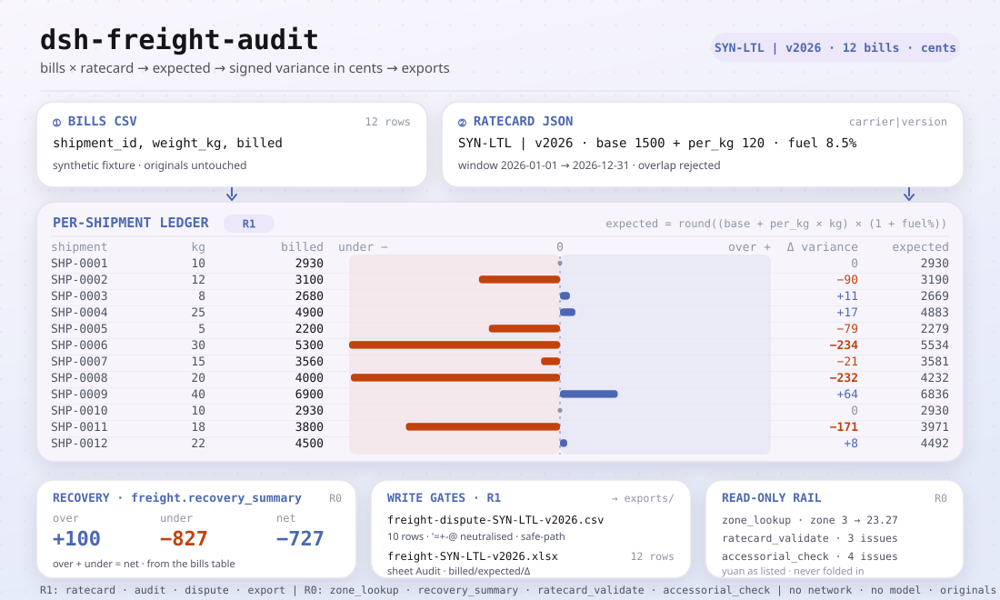

<div align="center">

<picture>
  <source media="(prefers-color-scheme: dark)" srcset="docs/assets/dsh-freight-audit-hero-zh-dark.webp">
  
</picture>

# dsh-freight-audit

**把承运商账单逐票对上费率卡，算出多收少收，并导出争议单和底稿。**

面向 DeepSeek Harness 的纯本地运费对账插件：费率卡版本化、按「基础价 + 每公斤价 × 重量」再加燃油百分比逐票算应计金额、以分为单位记差额、导出 xlsx 底稿与争议 CSV——不联网、不调用模型、不上传。

[安装](#三步上手) · [配置](#配置) · [FAQ](#faq) · [简体中文](README.md) · [English](README.en.md) · [Español](README.es.md) · [Português](README.pt.md) · [हिन्दी](README.hi.md)

[](LICENSE)
[](#兼容性)
[](https://www.npmjs.com/package/dsh-freight-audit)
[](https://github.com/PerryLink/dsh-freight-audit/actions/workflows/ci.yml)
[](#兼容性)

[](https://github.com/PerryLink/dsh-freight-audit/stargazers)
[](https://www.npmjs.com/package/dsh-freight-audit)
[](https://dshfind.com/plugins/PerryLink/dsh-freight-audit?ref=badge)
[](https://dsh.market/)
[](https://gitee.com/perrylink/dsh-freight-audit)

```sh
dsh plugin --profile <profile> add dsh-freight-audit
```

</div>

<sub>社区插件，与 DeepSeek 官方无关。唯一仓库：<https://github.com/PerryLink/dsh-freight-audit>（Gitee 为镜像）。状态：alpha · 仅用公开/合成数据验证 · 非 GA——不含客户数据或客户证据，不作生产可用声明。</sub>

## 它是什么

运费对账的本地流水线：`freight_ratecard` 把某个承运商某个版本的费率卡存进本地存储域（基础价、每公斤价、燃油百分比、生效区间），`freight_audit` 读入一车 CSV 账单，逐票按 `base_cents + per_kg_cents × weight_kg` 再加 `fuel_pct` 算应计金额，差额以分为单位记在账单上，`freight_recovery_summary` 汇总多收/少收/净额，`freight_dispute` 与 `freight_export` 分别导出争议 CSV 与 xlsx 底稿。全部计算在本机完成——不联网、不调用模型、不上传；输入由会话读取后作为参数传给工具，原文件不动。

- **适合**：几十到几千票的月结运费账单（CSV）；对账期初先查差额、再决定向承运商追多少。
- **不适合**：没有重量或金额的手工记录；直连 TMS / 承运商门户（本包不连外部系统）；替代正式索赔或法律程序。

<picture>
  <source media="(prefers-color-scheme: dark)" srcset="docs/assets/dsh-freight-audit-flow-v5-dark.svg">
  
</picture>

## 三步上手

1. **安装**（三选一）：

   ```sh
   # npm 通道（推荐，已发布版本）
   dsh plugin --profile <profile> add dsh-freight-audit
   # git 通道（最新 main；等价于 git+https://github.com/PerryLink/dsh-freight-audit.git）
   dsh plugin --profile <profile> add github:PerryLink/dsh-freight-audit
   # tarball 通道：本仓库 pnpm pack 后
   dsh plugin --profile <profile> add ./dsh-freight-audit-<version>.tgz
   ```

2. **最小配置**（安装命令已自动应用 bundle patch；手写 profile 时照抄这一行即可）：

   ```yaml
   - insert:
       - id: dsh-freight-audit
         name: dsh-freight-audit
   ```

   本插件没有任何插件级配置键；费率卡字段、账单表头与 zone 表在调用工具时传入，见「配置」。

3. **验证已生效**：

   ```sh
   dsh --profile <profile> --dump-config | grep dsh-freight-audit
   ```

   仓库自带合成样例，跑完应输出 `quickstart ok`：

   ```sh
   node samples/quickstart/run.mjs --check
   ```

   在会话里也可以直接说：

   > 我有一车承运商账单，帮我按费率卡逐票核对，把多收少收的差额和要追回的金额算出来。

**卸载**：`dsh plugin --profile <profile> remove dsh-freight-audit`（或从 profile patch 删掉该行）。

<details>
<summary>从 DSH Desktop 市场安装</summary>

所有 PerryLink 插件均可在 DSH Desktop 内置市场中浏览：**市场 → 来源 → 添加来源 → 粘贴** `https://perrylink-dsh-catalog.perrylink.workers.dev/catalog-source.json` **→ 选中**。安装仍需通过市场的 npm 身份校验与你的确认。

</details>

## 核心能力

- **费率卡版本化** —— `freight_ratecard` 的 `set` 写入一张费率卡，`list` 读出全部；同一承运商的两个版本生效期重叠时响亮拒绝（`E_FREIGHT_RATE_OVERLAP`），旧版本未填 `effective_to` 视为无限期。
- **逐票审计与差额** —— `freight_audit` 解析账单 CSV，按费率卡算每票应计金额与差额（单位：分），把逐票结果写入本地存储域，并返回异常票号列表。
- **追回汇总** —— `freight_recovery_summary` 汇总某承运商某版本的多收、少收与净额，只读，不覆盖已存账单。
- **争议单导出** —— `freight_dispute` 只挑出差额非零的票，导出争议复核 CSV；文本字段做公式注入中和，路径经 safe-path 守卫，不向承运商提交任何内容。
- **底稿导出** —— `freight_export` 把逐票 `billed/expected/variance` 写成一张 xlsx 工作表，返回路径与行数。
- **zone 公布价查询** —— `freight_zone_lookup` 从公开 zone/费率 CSV 查某一 zone 的公布价，只读，不参与审计计算。
- **费率卡与附加费体检** —— `freight_ratecard_validate` 检查金额字段、燃油比例、生效窗口与版本重叠；`freight_accessorial_check` 检查附加费类型、整数金额、重复、约定清单与总额上限。
- **纯本地** —— 源码中没有 HTTP / DNS / WebSocket 调用；不连接 TMS / 承运商系统，不上传数据。

### 工具面

工具名是稳定 API；写本地文件的工具标 **R1（本地写）**，只读工具标 **R0**。`freight_audit` 会把逐票结果写入本地存储域，因此同样标 R1。

| 工具 | 用途 | 风险 |
|---|---|---|
| `freight_ratecard` | 注册/版本化运费费率卡；`set` 写入，`list` 只读 | R1 本地写（`set`） |
| `freight_audit` | 按费率卡审核承运商账单，逐票写入应计与差额 | R1 本地写 |
| `freight_zone_lookup` | 查询公开的区划/费率表 | R0 只读 |
| `freight_recovery_summary` | 汇总多收/少收/净追回金额 | R0 只读 |
| `freight_dispute` | 导出用于争议复核的差异 CSV | R1 本地写 |
| `freight_export` | 导出审计 xlsx 底稿 | R1 本地写 |
| `freight_ratecard_validate` | 费率卡体检：金额、燃油比例、生效期、版本重叠 | R0 只读 |
| `freight_accessorial_check` | 附加费校验：类型、金额、重复、约定清单、总额上限 | R0 只读 |

### 输入与输出

输入：

- 账单 CSV：UTF-8，表头 `shipment_id,weight_kg,billed`；`billed` 写金额（如 `23.00`），`weight_kg` 写正数。
- 费率卡 JSON：`carrier`、`version`、`base_cents`、`per_kg_cents`、`fuel_pct`、`effective_from`，可选 `effective_to`。
- zone CSV：表头 `zone,list_rate`；`list_rate` 按元计，工具换算为分。
- 大小：建议单批 ≤ 5 MB（约 2 万票）；自带样例 12 票，约 0.3 KB。
- 来源：从 TMS / 承运商月结单导出后另存为 CSV；原文件不会被修改。

输出：

- 终端摘要：账单票数、异常票、差额合计、多收 / 少收 / 净额、zone 公布价、费率卡与附加费问题。
- 文件：底稿 `xlsx`（逐票 `billed/expected/variance`）与争议单 `CSV`，落在 `$DSH_HOME/storages/dsh-freight-audit/exports/`；不改原账单。
- 样例金标：`samples/quickstart/expected/result.json`（由真实运行产生）。

### 示例

自带合成样例（随包发布，非真实承运商数据）：

```sh
node samples/quickstart/run.mjs          # 人类可读摘要
node samples/quickstart/run.mjs --json   # 规范化结果（金标来源）
node samples/quickstart/run.mjs --check  # 与金标比对，结尾 quickstart ok
```


*截图是 `node samples/quickstart/run.mjs --check` 的真实终端输出；命令与输出哈希见 `screenshots.json`（2026-11-02 真实运行），金标为 `samples/quickstart/expected/result.json`。*

公开 fixture 验收：重跑 `node scripts/acceptance.mjs`，明细见 `ACCEPTANCE.csv`：

| req_id | metric | threshold | actual | pass | source | counted |
|---|---|---|---|---|---|---|
| SKU-12-A01 | 账单解析（30） | 30/30 | 30 | true | public/synthetic | false |
| SKU-12-A02 | 异常票 | 5 | 5 | true | public/synthetic | false |
| SKU-12-A03 | 差额合计分 | 500 | 500 | true | public/synthetic | false |
| SKU-12-A04 | 底稿 sheet | 1 | 1 | true | public/synthetic | false |
| SKU-12-A05 | 公开 zone rate | 2327 | 2327 | true | public/synthetic | false |
| SKU-12-A06 | 追回汇总净额 | 100 | 100 | true | public/synthetic | false |
| SKU-12-A07 | 费率卡重叠检测 | 1 | 1 | true | public/synthetic | false |
| SKU-12-A08 | 附加费校验 | 1 | 1 | true | public/synthetic | false |
| PS1-QS01 | quickstart 样例与金标一致 | 1/1 | 1 | true | synthetic/quickstart | true |

*SKU 行是公开/合成 fixture 检查（`counted=false`）；PS1-QS01 是随包样例的本地复现（`counted=true`）。均非客户运行，没有虚构输出。*

## 配置

本插件没有 Schemastery `Config` 配置键——`cordis.patch.yml` 只 `insert` 一行（见「三步上手」），没有可覆盖的插件级配置项。费率卡字段在调用 `freight_ratecard` 时传入：

| 字段 | 类型 | 含义 |
|---|---|---|
| `carrier` | string，必填 | 承运商标识，如 `SYN-LTL` |
| `version` | string，必填 | 费率卡版本，如 `v2026` |
| `base_cents` | 非负整数（分） | 每票基础价 |
| `per_kg_cents` | 非负整数（分/公斤） | 每公斤单价 |
| `fuel_pct` | 0–100 的数字 | 燃油附加费百分比；应计 = (base + per_kg × 重量) × (1 + fuel_pct/100) |
| `effective_from` | `YYYY-MM-DD` | 生效起始日 |
| `effective_to` | `YYYY-MM-DD`，可选 | 生效结束日；省略 = `9999-12-31` |

账单与 zone 输入：

| 输入 | 表头 | 规则 |
|---|---|---|
| 账单 CSV | `shipment_id,weight_kg,billed` | 金额最多两位小数；重量为正数；表头缺列报 `E_FREIGHT_CSV_INVALID` |
| zone CSV | `zone,list_rate` | `zone` 为整数；`list_rate` 按元计 |

存储位置可用环境变量 `DSH_FREIGHT_HOME` 覆盖；默认是 `$DSH_HOME/storages/dsh-freight-audit`。

<details>
<summary>完整取值：附加费类型与错误码</summary>

`freight_accessorial_check` 认识 12 种附加费类型：`fuel`、`detention`、`liftgate`、`residential`、`inside_delivery`、`appointment`、`oversize`、`hazmat`、`waiting_time`、`reweigh`、`redelivery`、`storage`。

错误统一为 `<一句人话>（E_XXX）｜下一步：<动作>`；错误码包括：`E_FREIGHT_CSV_INVALID`、`E_FREIGHT_RATE_MISSING`、`E_FREIGHT_RATE_OVERLAP`、`E_FREIGHT_EXPORT_FAILED`、`E_FREIGHT_PATH_INVALID`、`E_FREIGHT_PATH_NOT_ALLOWED`。体检与附加费工具还会返回 `E_FREIGHT_RATE_INVALID` 与 `E_FREIGHT_ACCESSORIAL_*` 问题码。逐条症状/原因/动作见 [TROUBLESHOOTING.md](TROUBLESHOOTING.md)。

</details>

## FAQ

<details>
<summary>数据到底存在哪？会改我的账单吗？</summary>

费率卡与逐票结果只写本地存储域 `$DSH_HOME/storages/dsh-freight-audit`（`rates` / `bills` 两张表）；底稿 xlsx 与争议 CSV 写在它的 `exports/` 子目录。输入 CSV 由会话读取后作为参数传给工具——原账单不会被修改，也没有任何数据被上传。

</details>

<details>
<summary>装不上怎么办？</summary>

确认 DSH `>=0.2.1-rc.3 <0.4.0`、Node `>=24.9 <25`，并用全新的 `DSH_HOME` 重试；完整步骤见 [TROUBLESHOOTING.md](TROUBLESHOOTING.md) 第 1 条。

</details>

<details>
<summary>结果不对怎么办？</summary>

先跑 `node samples/quickstart/run.mjs --check`；再检查账单表头是否为 `shipment_id,weight_kg,billed`、金额是否两位小数。差额 = 账单金额 − 费率卡应计金额，单位是分；应计只按重量与燃油计算，zone 公布价与附加费是独立只读工具，不会自动并入。

</details>

<details>
<summary>能处理我的真实账单吗？</summary>

可以本地运行，但本包是 alpha、只用公开/合成数据验证，不构成审计或索赔结论；真实数据请先脱敏，不要把真实承运商账单贴进 issue。

</details>

<details>
<summary>会联网或上传数据吗？</summary>

不会。工具、样例和导出都在本机完成；源码中没有 HTTP / DNS / WebSocket 调用。

</details>

## 安全边界

- **不联网、不调用模型。** 除非工具明确说明，否则没有模型或网络调用；输入和输出都留在本地。
- **原账单不被修改。** 写路径只落在 `$DSH_HOME/storages/dsh-freight-audit`（费率卡/账单状态与 `exports/*.xlsx`、`exports/*.csv`）。
- **导出路径穿越防护。** 导出文件名必须匹配 `[A-Za-z0-9._-]{1,120}`，解析后的路径必须留在导出目录内，并在 `realpath` 后重新锚定；越界报 `E_FREIGHT_PATH_INVALID` / `E_FREIGHT_PATH_NOT_ALLOWED`。
- **争议 CSV 公式注入防护。** 文本字段以 `=`、`+`、`-`、`@` 开头时先加 `'` 中和，再按需加引号转义；金额用数字字段，负数不会被误判为公式。
- **错误格式统一、失败响亮。** 报错统一为 `<一句人话>（E_XXX）｜下一步：<动作>`；技术细节（`detail`）只留给日志，不拼进用户可见文案。
- **仅公开/合成数据。** 仓库不含客户数据或客户证据，验收行全部标注来源与 `counted` 状态。

## 权限与数据

- **读**：你指定的运费账单 CSV、费率卡 JSON、zone 价目表；不读其他目录。
- **写**：`$DSH_HOME/storages/dsh-freight-audit`（费率卡与逐票账单状态、`exports/*.xlsx`、`exports/*.csv`）；不改原账单。
- **联网**：否（源码中没有 HTTP / DNS / WebSocket 调用）。
- **外部系统**：无（不连接 TMS / 承运商系统，不上传数据）。
- **数据边界**：仅公开/合成样例验证；不含客户数据或客户证据。
- **持续维护**：新功能与加固随 alpha 版本发布。

## 已知限制

- **仅公开/合成数据验证。** `EVIDENCE.md` 记录 0 家真实承运商、30 张合成账单、4 行通过；`ACCEPTANCE.csv` 的 SKU 行 `counted=false`，PS1-QS01 为样例本地复现 `counted=true`。
- **alpha / partial / not counted / 非 GA。** 不作生产可用声明，不构成审计、索赔或付款结论。
- **只做本地对账，不提交索赔。** 不连接承运商门户、不发送争议单、不替代正式索赔或法律程序。
- **输入格式约束。** 账单表头必须逐字匹配（缺列报 `E_FREIGHT_CSV_INVALID`）；金额最多两位小数；重量必须为正数；建议单批 ≤5 MB。
- **审计公式只用重量与燃油。** 应计 = (base + per_kg × 重量) × (1 + fuel_pct/100)；zone 公布价与附加费是独立只读工具，不自动并入应计金额。
- **每个工具的精确边界**见「核心能力」的工具表与 `ACCEPTANCE.csv`。

## 兼容性

| 维度 | 状态 |
|---|---|
| Harness | DeepSeek Harness `>=0.2.1-rc.3 <0.4.0`（`package.json` 的 `engines.dsh`） |
| Node | `>=24.9.0 <25`（`.nvmrc`：24） |
| 平台 | 任何 DSH 可运行处；仅本地文件 |
| 数据 | 不联网、不调用模型、不上传 |

## 生态与质量

- [Gitee 镜像](https://gitee.com/perrylink/dsh-freight-audit)（同步镜像，以 GitHub 为准）
- [dshfind 插件页](https://dshfind.com/plugins/PerryLink/dsh-freight-audit)（安装量与排名）
- [DSH Market](https://dsh.market/)（已上架）
- **1024 商店渠道**：先 `npm i -g dsh1024`，再 `dsh1024 plugin --profile <profile> add dsh-freight-audit`（计入 [deepseek1024.com](https://deepseek1024.com) 安装排行）
- [领域索引](https://perrylink.github.io/dsh-plugins/) · [Checker 家族](https://perrylink.github.io/zh/checkers/)

### 相关项目与核查器

兄弟包与家族索引：[dsh-hs-candidate](https://github.com/PerryLink/dsh-hs-candidate) · [dsh-pim-lint](https://github.com/PerryLink/dsh-pim-lint)

每个核查器都是独立包、各有自己的规则包与版本，按需安装：

| 包 | 为何相关 |
|---|---|
| [`dsh-demurrage-ledger`](https://github.com/PerryLink/dsh-demurrage-ledger) | 滞期/滞箱台账的完整性与算术 |
| [`dsh-lc-doc-check`](https://github.com/PerryLink/dsh-lc-doc-check) | 信用证交单清单与日期核对 |
| [`dsh-customs-doc-check`](https://github.com/PerryLink/dsh-customs-doc-check) | 报关单据一致性 |

## 开发

```sh
pnpm install --frozen-lockfile                            # node >=24.9 <25
pnpm build && pnpm lint && pnpm typecheck && pnpm test    # tsc 构建 + lint + 29 个 node --test 用例
pnpm gate:sku12                                           # 验收门禁（ACCEPTANCE.csv）
node scripts/acceptance.mjs                               # 重跑公开/合成验收
node samples/quickstart/run.mjs --check                   # 合成样例，应输出 quickstart ok
```

当前版本 `0.2.0`（与 `package.json` 一致）。测试：`node --test test/*.test.mjs`（10 个测试文件、29 个用例；`pnpm test` 已内置构建步骤）。配图由 [`scripts/gen-readme-assets.py`](scripts/gen-readme-assets.py) 程序化生成（Python/Pillow 出 1440×576 hero 双语深浅 webp，手写 SVG 出 1100×660 结构图深浅双版，五语共用），可重复执行：`python scripts/gen-readme-assets.py`。

Topics：`deepseek-harness`, `dsh`, `dsh-plugin`, `freight`, `audit`, `logistics`, `perrylink`, `ratecard`

## 家族与致谢

本项目是 [PerryLink](https://github.com/PerryLink) 维护的 DeepSeek Harness 插件家族成员（全部 Apache-2.0）。如果这个插件帮到了你，**给个 star**——它不解锁任何功能，但会让下一个人更容易找到它。

- [@PerryLink](https://github.com/PerryLink) —— 创建者与维护者：费率卡版本化与逐票审计引擎、八个 `freight_*` 工具、quickstart 样例与验收套件、五语文档。

## License

[LICENSE](LICENSE)（Apache License 2.0）© 2026 dsh-freight-audit contributors；另见 `NOTICE` 与 `THIRD-PARTY-NOTICES`。

<p align="center"><sub>Apache-2.0 · 社区插件，与 DeepSeek 无关。</sub></p>
