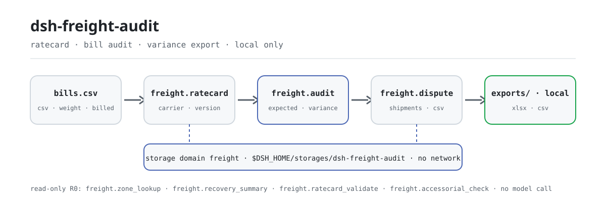

<div align="center">

<picture>
  <source media="(prefers-color-scheme: dark)" srcset="docs/assets/dsh-freight-audit-flow-dark.svg">
  
</picture>

# dsh-freight-audit

**Concilie as faturas das transportadoras linha a linha com a sua tarifa: veja o que foi cobrado a mais e a menos e exporte o arquivo de disputa com a planilha de trabalho.**

Um plugin de auditoria de frete puramente local para DeepSeek Harness: tarifas versionadas, custo esperado a partir de base + por kg × peso mais um percentual de combustível, variação em centavos e uma planilha xlsx com um CSV de disputa — sem rede, sem chamada a modelo, sem upload.

[Instalar](#instalação-em-três-passos) · [Configuração](#configuração) · [FAQ](#faq) · [简体中文](README.md) · [English](README.en.md) · [Español](README.es.md) · [Português](README.pt.md) · [हिन्दी](README.hi.md)

[](LICENSE)
[](#compatibilidade)
[](https://www.npmjs.com/package/dsh-freight-audit)
[](https://github.com/PerryLink/dsh-freight-audit/actions/workflows/ci.yml)
[](#compatibilidade)

[](https://github.com/PerryLink/dsh-freight-audit/stargazers)
[](https://www.npmjs.com/package/dsh-freight-audit)
[](https://dshfind.com/plugins/PerryLink/dsh-freight-audit?ref=badge)
[](https://dsh.market/)
[](https://gitee.com/perrylink/dsh-freight-audit)

```sh
dsh plugin --profile <profile> add dsh-freight-audit
```

</div>

<sub>Plugin da comunidade, não afiliado ao DeepSeek. Repositório canônico: <https://github.com/PerryLink/dsh-freight-audit> (Gitee é um espelho). Status: alpha · verificado apenas com dados públicos/sintéticos · não GA — sem dados nem evidência de clientes, sem promessa de produção.</sub>

## O que é

Uma canalização local para conciliação de frete: `freight.ratecard` guarda uma tarifa de transportadora/versão no domínio de armazenamento local (preço base, preço por kg, percentual de combustível, janela de vigência), `freight.audit` lê um lote CSV de faturas e calcula o custo esperado por embarque como `base_cents + per_kg_cents × weight_kg` mais `fuel_pct`, registra a variação em centavos em cada fatura, `freight.recovery_summary` agrega cobrança a mais/cobrança a menos/líquido, e `freight.dispute` e `freight.export` gravam o CSV de disputa e a planilha xlsx. Tudo roda na sua máquina — sem rede, sem chamada a modelo, sem upload; as entradas são lidas pela sessão e passadas às ferramentas como argumentos, e os arquivos originais não são tocados.

- **Indicado para**: faturas mensais de frete de dezenas a milhares de embarques (CSV); conferir primeiro a variação e depois decidir quanto cobrar da transportadora.
- **Não indicado para**: registros manuais sem peso ou valor; integração direta com TMS / portais de transportadoras (este pacote não se conecta a nenhum sistema externo); substituir uma reclamação formal ou processo legal.

## Instalação em três passos

1. **Instalar** (escolha um canal):

   ```sh
   # canal npm (recomendado; versões publicadas)
   dsh plugin --profile <profile> add dsh-freight-audit
   # canal git (main mais recente; equivalente a git+https://github.com/PerryLink/dsh-freight-audit.git)
   dsh plugin --profile <profile> add github:PerryLink/dsh-freight-audit
   # canal tarball: pnpm pack neste repo, depois
   dsh plugin --profile <profile> add ./dsh-freight-audit-<version>.tgz
   ```

2. **Configuração mínima** (o comando de instalação já aplica o bundle patch; perfis escritos à mão colam esta única linha):

   ```yaml
   - insert:
       - id: dsh-freight-audit
         name: dsh-freight-audit
   ```

   O plugin não tem chaves de configuração próprias; os campos da tarifa, os cabeçalhos de fatura e a tabela de zonas são passados como argumentos da ferramenta — ver «Configuração».

3. **Verificar que monta**:

   ```sh
   dsh --profile <profile> --dump-config | grep dsh-freight-audit
   ```

   O repo traz uma amostra sintética: rode uma vez (deve terminar com `quickstart ok`):

   ```sh
   node samples/quickstart/run.mjs --check
   ```

Dentro de uma sessão, basta pedir (prompt citado de `dsh.demo` no `package.json`):

```text
我有一车承运商账单，帮我按费率卡逐票核对，把多收少收的差额和要追回的金额算出来。
```

**Desinstalar**: `dsh plugin --profile <profile> remove dsh-freight-audit` (ou remova a linha do patch do perfil).

<details>
<summary>Instalar pela loja do DSH Desktop</summary>

Todos os plugins da PerryLink estão na loja embutida do DSH Desktop: **Market → Sources → Add source → cole** `https://perrylink-dsh-catalog.perrylink.workers.dev/catalog-source.json` **→ selecione**. A instalação ainda exige a verificação de identidade npm da loja e a sua confirmação.

</details>

## Capacidades principais

- **Tarifas versionadas** — `freight.ratecard` com `set` guarda uma tarifa e `list` lê todas; duas versões da mesma transportadora com janelas de vigência sobrepostas são rejeitadas em voz alta (`E_FREIGHT_RATE_OVERLAP`), e um `effective_to` ausente significa que a versão fica aberta.
- **Auditoria e variação por embarque** — `freight.audit` analisa o CSV de faturas, calcula o custo esperado e a variação por embarque (em centavos), grava o resultado por embarque no domínio de armazenamento local e devolve a lista de embarques atípicos.
- **Resumo de recuperação** — `freight.recovery_summary` agrega cobrança a mais, cobrança a menos e líquido para uma transportadora/versão; somente leitura, nunca sobrescreve faturas gravadas.
- **Exportação de disputa** — `freight.dispute` seleciona apenas variações diferentes de zero e exporta um CSV de revisão de disputa; campos de texto são neutralizados contra injeção de fórmulas, o caminho passa pela guarda safe-path e nada é enviado à transportadora.
- **Exportação da planilha de trabalho** — `freight.export` grava `billed/expected/variance` por embarque numa única aba xlsx e devolve o caminho e o número de linhas.
- **Consulta de tarifa de zona** — `freight.zone_lookup` lê um CSV público de zona/tarifa e devolve a tarifa publicada para uma zona; somente leitura, nunca entra no cálculo da auditoria.
- **Higiene de tarifas e adicionais** — `freight.ratecard_validate` confere campos monetários, percentual de combustível, janela de vigência e sobreposição de versões; `freight.accessorial_check` confere tipo de adicional, valor inteiro, duplicatas, pertença à lista acordada e teto total.
- **Puramente local** — sem chamadas HTTP / DNS / WebSocket no código; sem conexões com TMS nem sistemas de transportadoras, nada é enviado.

### Superfície de ferramentas

Os nomes das ferramentas são uma API estável. Ferramentas que escrevem arquivos locais são marcadas **R1 (escrita local)**, as de somente leitura **R0**. `freight.audit` grava os resultados por embarque no domínio de armazenamento local, por isso também é R1.

| Ferramenta | Finalidade | Risco |
|---|---|---|
| `freight.ratecard` | Registrar/versionar uma tarifa de frete; `set` escreve, `list` é somente leitura | R1 escrita local (`set`) |
| `freight.audit` | Auditar faturas da transportadora contra a tarifa; gravar esperado/variação por embarque | R1 escrita local |
| `freight.zone_lookup` | Consultar uma tabela pública de zona/tarifa | R0 somente leitura |
| `freight.recovery_summary` | Resumir cobrança a mais/a menos/líquido | R0 somente leitura |
| `freight.dispute` | Exportar um CSV de variações para revisão de disputa | R1 escrita local |
| `freight.export` | Exportar a planilha xlsx de auditoria | R1 escrita local |
| `freight.ratecard_validate` | Higiene de tarifas: campos monetários, combustível, vigência, sobreposição | R0 somente leitura |
| `freight.accessorial_check` | Validação de adicionais: tipo, valor, duplicatas, lista acordada, teto | R0 somente leitura |

### Entrada e saída

Entrada:

- CSV de faturas: UTF-8, cabeçalho `shipment_id,weight_kg,billed`; `billed` leva o valor (ex.: `23.00`) e `weight_kg` é um número positivo.
- JSON de tarifa: `carrier`, `version`, `base_cents`, `per_kg_cents`, `fuel_pct`, `effective_from`, `effective_to` opcional.
- CSV de zonas: cabeçalho `zone,list_rate`; `list_rate` vai em unidades monetárias e a ferramenta converte para centavos.
- Tamanho: mantenha cada lote ≤5 MB (cerca de 20.000 embarques); a amostra incluída tem 12 embarques, cerca de 0,3 KB.
- Origem: exporte do TMS ou do extrato mensal da transportadora e salve como CSV; o arquivo original nunca é modificado.

Saída:

- Resumo no terminal: número de faturas, faturas atípicas, variação total, cobrança a mais/a menos/líquido, tarifa de zona e problemas de tarifa/adicionais.
- Arquivos: a planilha `xlsx` (`billed/expected/variance` por embarque) e o `CSV` de disputa, em `$DSH_HOME/storages/dsh-freight-audit/exports/`; a fatura original não é tocada.
- Arquivo de ouro da amostra: `samples/quickstart/expected/result.json` (produzido por uma execução real).

### Exemplos

Amostra sintética incluída (publicada com o pacote, não são dados reais de transportadoras):

```sh
node samples/quickstart/run.mjs          # resumo legível
node samples/quickstart/run.mjs --json   # resultado canônico (origem do arquivo de ouro)
node samples/quickstart/run.mjs --check  # compara com o ouro; termina com quickstart ok
```


*A captura é a saída real de terminal de `node samples/quickstart/run.mjs --check`; o comando e os hashes de saída estão em `screenshots.json` (execução real de 2026-11-02), e o arquivo de ouro é `samples/quickstart/expected/result.json`.*

Aceitação com fixture pública: repita `node scripts/acceptance.mjs`; detalhe em `ACCEPTANCE.csv`:

| req_id | metric | threshold | actual | pass | source | counted |
|---|---|---|---|---|---|---|
| SKU-12-A01 | Análise de faturas (30) | 30/30 | 30 | true | public/synthetic | false |
| SKU-12-A02 | Faturas atípicas | 5 | 5 | true | public/synthetic | false |
| SKU-12-A03 | Variação total (centavos) | 500 | 500 | true | public/synthetic | false |
| SKU-12-A04 | Aba da planilha de trabalho | 1 | 1 | true | public/synthetic | false |
| SKU-12-A05 | Tarifa pública de zona | 2327 | 2327 | true | public/synthetic | false |
| SKU-12-A06 | Líquido de recuperação | 100 | 100 | true | public/synthetic | false |
| SKU-12-A07 | Detecção de sobreposição de tarifas | 1 | 1 | true | public/synthetic | false |
| SKU-12-A08 | Validação de adicionais | 1 | 1 | true | public/synthetic | false |
| PS1-QS01 | Amostra quickstart confere com o ouro | 1/1 | 1 | true | synthetic/quickstart | true |

*As linhas SKU são verificações de fixture pública/sintética (`counted=false`); PS1-QS01 é uma reprodução local da amostra incluída (`counted=true`). Nenhuma é execução de cliente e nenhuma saída é inventada.*

## Configuração

Este plugin não tem chaves `Config` do Schemastery — `cordis.patch.yml` apenas `insert` uma linha (ver «Instalação em três passos»), então não há chave de plugin para sobrescrever. Os campos da tarifa são passados ao chamar `freight.ratecard`:

| Campo | Tipo | Significado |
|---|---|---|
| `carrier` | string, obrigatório | Id da transportadora, ex.: `SYN-LTL` |
| `version` | string, obrigatório | Versão da tarifa, ex.: `v2026` |
| `base_cents` | inteiro não negativo (centavos) | Preço base por embarque |
| `per_kg_cents` | inteiro não negativo (centavos/kg) | Preço por quilograma |
| `fuel_pct` | número 0–100 | Percentual de adicional de combustível; esperado = (base + per_kg × peso) × (1 + fuel_pct/100) |
| `effective_from` | `YYYY-MM-DD` | Data de início da vigência |
| `effective_to` | `YYYY-MM-DD`, opcional | Data de fim da vigência; omitida = `9999-12-31` |

Entradas de fatura e zona:

| Entrada | Cabeçalho | Regra |
|---|---|---|
| CSV de faturas | `shipment_id,weight_kg,billed` | Valor com no máximo duas casas decimais; peso positivo; coluna ausente eleva `E_FREIGHT_CSV_INVALID` |
| CSV de zonas | `zone,list_rate` | `zone` é inteiro; `list_rate` em unidades monetárias |

O local de armazenamento pode ser sobrescrito pela variável de ambiente `DSH_FREIGHT_HOME`; o padrão é `$DSH_HOME/storages/dsh-freight-audit`.

<details>
<summary>Valores completos: tipos de adicional e códigos de erro</summary>

`freight.accessorial_check` entende 12 tipos de adicional: `fuel`, `detention`, `liftgate`, `residential`, `inside_delivery`, `appointment`, `oversize`, `hazmat`, `waiting_time`, `reweigh`, `redelivery`, `storage`.

Os erros seguem um formato único — mensagem simples, código `E_XXX` e próximo passo. Os códigos incluem: `E_FREIGHT_CSV_INVALID`, `E_FREIGHT_RATE_MISSING`, `E_FREIGHT_RATE_OVERLAP`, `E_FREIGHT_EXPORT_FAILED`, `E_FREIGHT_PATH_INVALID`, `E_FREIGHT_PATH_NOT_ALLOWED`. As ferramentas de validação e adicionais também devolvem `E_FREIGHT_RATE_INVALID` e códigos de problema `E_FREIGHT_ACCESSORIAL_*`. Sintoma/causa/ação por código: [TROUBLESHOOTING.md](TROUBLESHOOTING.md).

</details>

## FAQ

<details>
<summary>Onde ficam os dados? Minhas faturas são alteradas?</summary>

Tarifas e resultados por embarque são gravados apenas no domínio de armazenamento local `$DSH_HOME/storages/dsh-freight-audit` (as tabelas `rates` / `bills`); a planilha xlsx e o CSV de disputa vão para o subdiretório `exports/`. O CSV de entrada é lido pela sessão e passado às ferramentas como argumentos — a fatura original nunca é modificada e nada é enviado.

</details>

<details>
<summary>Não instala, e agora?</summary>

Confirme DSH `>=0.2.1-rc.3 <0.4.0` e Node `>=24.9 <25`, e tente de novo com um `DSH_HOME` novo; os passos completos estão em [TROUBLESHOOTING.md](TROUBLESHOOTING.md), item 1.

</details>

<details>
<summary>Os números não batem, o que verifico?</summary>

Primeiro rode `node samples/quickstart/run.mjs --check`; depois confira se o cabeçalho da fatura é exatamente `shipment_id,weight_kg,billed` e se os valores têm duas casas decimais. Variação = valor faturado − valor esperado da tarifa, em centavos; o esperado usa apenas peso e combustível, enquanto a tarifa de zona e os adicionais são ferramentas de somente leitura separadas e nunca entram no valor esperado.

</details>

<details>
<summary>Dá para processar minhas faturas reais?</summary>

Roda localmente, mas o pacote é alpha e só foi verificado com dados públicos/sintéticos — não constitui conclusão de auditoria nem de reclamação. Anonimize os dados reais antes de usar e não cole faturas reais de transportadoras num issue.

</details>

<details>
<summary>Faz chamadas de rede ou envia dados?</summary>

Não. As ferramentas, a amostra e as exportações rodam na sua máquina; o código não contém chamadas HTTP / DNS / WebSocket.

</details>

## Limites de segurança

- **Sem rede, sem chamada a modelo.** Salvo se uma ferramenta disser o contrário, não há chamada a modelo nem de rede; entrada e saída ficam locais.
- **As faturas originais nunca são modificadas.** As escritas caem apenas em `$DSH_HOME/storages/dsh-freight-audit` (estado de tarifas/faturas e `exports/*.xlsx`, `exports/*.csv`).
- **Guarda contra path traversal na exportação.** O nome do arquivo exportado deve casar com `[A-Za-z0-9._-]{1,120}`, o caminho resolvido deve ficar dentro do diretório de exportação e é re-ancorado após `realpath`; uma fuga eleva `E_FREIGHT_PATH_INVALID` / `E_FREIGHT_PATH_NOT_ALLOWED`.
- **Guarda contra injeção de fórmulas no CSV de disputa.** Campos de texto que começam com `=`, `+`, `-` ou `@` recebem `'` na frente antes de aspas/escape; dinheiro usa campos numéricos para que uma variação negativa não seja confundida com fórmula.
- **Erros uniformes, falhas em voz alta.** Os erros seguem um formato único — mensagem simples, código `E_XXX` e próximo passo; o detalhe técnico (`detail`) fica reservado ao log e nunca entra na mensagem visível.
- **Apenas dados públicos/sintéticos.** O repositório não contém dados nem evidência de clientes; cada linha de aceitação declara a origem e o estado `counted`.

## Permissões e dados

- **Lê**: os CSVs de faturas de frete, o JSON de tarifa e a tabela de tarifas de zona que você indicar; nenhum outro diretório.
- **Escreve**: `$DSH_HOME/storages/dsh-freight-audit` (estado de tarifas e faturas por embarque, `exports/*.xlsx`, `exports/*.csv`); a fatura original intacta.
- **Rede**: não (sem chamadas HTTP / DNS / WebSocket no código).
- **Sistemas externos**: nenhum (sem conexões com TMS nem sistemas de transportadoras, sem uploads).
- **Fronteira de dados**: verificado apenas com amostras públicas/sintéticas; sem dados nem evidência de clientes.
- **Manutenção ativa**: novos recursos e endurecimento chegam em versões alpha.

## Limitações conhecidas

- **Verificado apenas com dados públicos/sintéticos.** `EVIDENCE.md` registra 0 transportadoras reais, 30 faturas sintéticas e 4 linhas aprovadas; as linhas SKU de `ACCEPTANCE.csv` são `counted=false`, e PS1-QS01 é uma reprodução local da amostra com `counted=true`.
- **Alpha / parcial / não contabilizado / não GA.** Sem promessa de produção; não constitui conclusão de auditoria, reclamação ou pagamento.
- **Apenas conciliação local, sem envio de reclamações.** Não se conecta a portais de transportadoras, não envia o arquivo de disputa e não substitui uma reclamação formal ou processo legal.
- **Restrições de formato de entrada.** O cabeçalho da fatura deve coincidir literalmente (coluna ausente eleva `E_FREIGHT_CSV_INVALID`); valores com no máximo duas casas decimais; peso positivo; cada lote ≤5 MB.
- **A fórmula da auditoria usa apenas peso e combustível.** Esperado = (base + per_kg × peso) × (1 + fuel_pct/100); a tarifa de zona e os adicionais são ferramentas de somente leitura separadas e não entram no valor esperado.
- **Os limites exatos por ferramenta** são a tabela de ferramentas acima mais `ACCEPTANCE.csv`.

## Compatibilidade

| Superfície | Estado |
|---|---|
| Harness | DeepSeek Harness `>=0.2.1-rc.3 <0.4.0` (`engines.dsh` no `package.json`) |
| Node | `>=24.9.0 <25` (`.nvmrc`: 24) |
| Plataformas | Onde o DSH rodar; apenas arquivos locais |
| Dados | Sem rede, sem chamada a modelo, sem upload |

## Ecossistema e qualidade

- [Espelho no Gitee](https://gitee.com/perrylink/dsh-freight-audit) (espelho sincronizado; o GitHub é o canônico)
- [Página do plugin no dshfind](https://dshfind.com/plugins/PerryLink/dsh-freight-audit) (instalações e ranking)
- [DSH Market](https://dsh.market/) (listado)
- **Canal da loja 1024**: `npm i -g dsh1024` uma vez, depois `dsh1024 plugin --profile <profile> add dsh-freight-audit` (conta no ranking de instalações do [deepseek1024.com](https://deepseek1024.com))
- [Índice de domínio](https://perrylink.github.io/dsh-plugins/) · [Família de checkers](https://perrylink.github.io/zh/checkers/)

### Trabalho relacionado e checkers

Pacotes irmãos e índices da família: [dsh-hs-candidate](https://github.com/PerryLink/dsh-hs-candidate) · [dsh-pim-lint](https://github.com/PerryLink/dsh-pim-lint)

Cada checker é um pacote independente com seu próprio pacote de regras e versão; instale só os que precisar:

| Pacote | Por que é relevante |
|---|---|
| [`dsh-demurrage-ledger`](https://github.com/PerryLink/dsh-demurrage-ledger) | Integridade e aritmética do livro de demurrage/detenção |
| [`dsh-lc-doc-check`](https://github.com/PerryLink/dsh-lc-doc-check) | Lista de apresentação e datas da carta de crédito |
| [`dsh-customs-doc-check`](https://github.com/PerryLink/dsh-customs-doc-check) | Consistência dos documentos de declaração aduaneira |

## Desenvolvimento

```sh
pnpm install --frozen-lockfile                            # node >=24.9 <25
pnpm build && pnpm lint && pnpm typecheck && pnpm test    # build tsc + lint + 28 casos node --test
pnpm gate:sku12                                           # porta de aceitação (ACCEPTANCE.csv)
node scripts/acceptance.mjs                               # repetir a aceitação pública/sintética
node samples/quickstart/run.mjs --check                   # amostra sintética; deve imprimir quickstart ok
```

Versão atual `0.1.1` (confere com `package.json`). Testes: `node --test test/*.test.mjs` (9 arquivos de teste, 28 casos; `pnpm test` compila primeiro). As imagens do README são geradas programaticamente por [`scripts/gen-readme-assets.py`](scripts/gen-readme-assets.py) (Python; par SVG de fluxo claro/escuro compartilhado pelos cinco idiomas) e podem ser repetidas: `python scripts/gen-readme-assets.py`.

Topics: `deepseek-harness`, `dsh`, `dsh-plugin`, `freight`, `audit`, `logistics`, `perrylink`, `ratecard`

## Família e agradecimentos

Este projeto faz parte da família de plugins de DeepSeek Harness da [PerryLink](https://github.com/PerryLink) (todos Apache-2.0). Se for útil, **uma estrela ajuda a próxima pessoa a encontrá-lo** — nada fica bloqueado por trás dela.

- [@PerryLink](https://github.com/PerryLink) — criador e mantenedor: o motor de versionamento de tarifas e auditoria por embarque, as oito ferramentas `freight.*`, a amostra quickstart e a suíte de aceitação, e a documentação em cinco idiomas.

## Licença

[LICENSE](LICENSE) (Apache License 2.0) © 2026 dsh-freight-audit contributors; veja também `NOTICE` e `THIRD-PARTY-NOTICES`.

<p align="center"><sub>Apache-2.0 · Plugin da comunidade, não afiliado ao DeepSeek.</sub></p>
